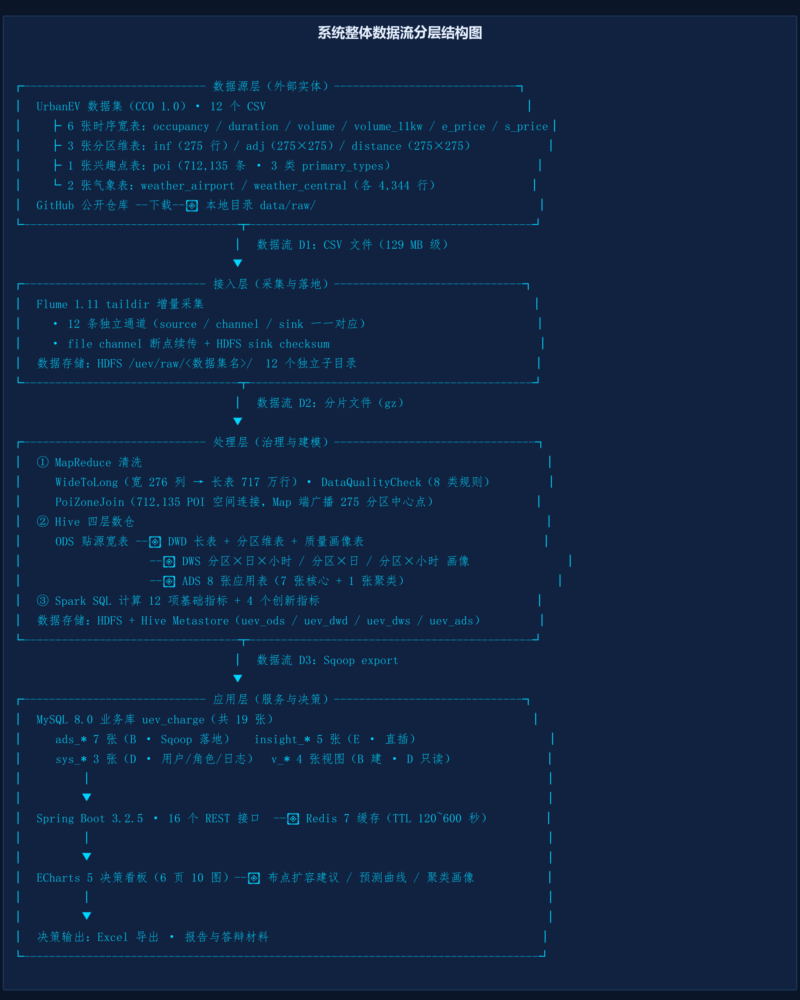
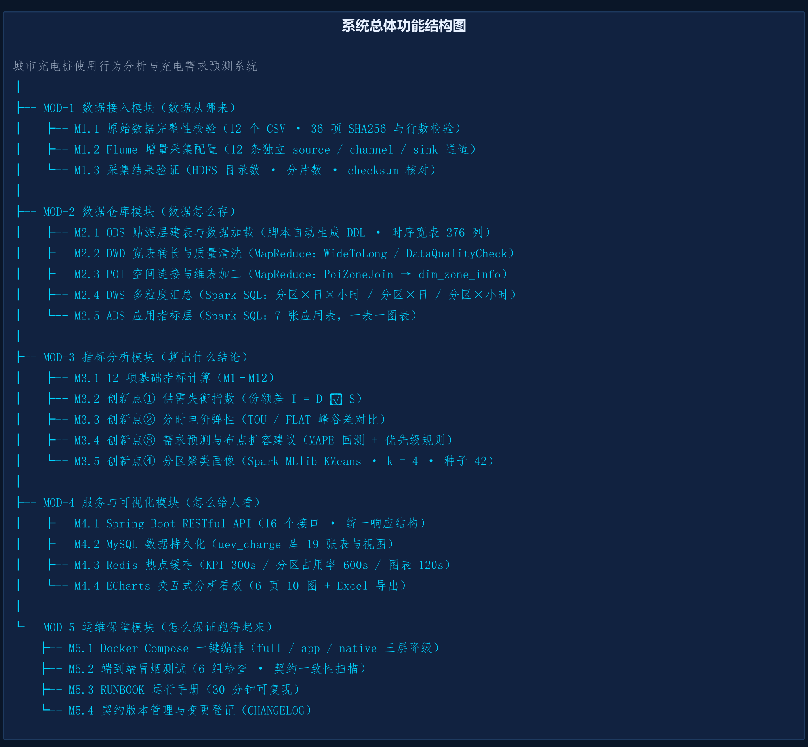
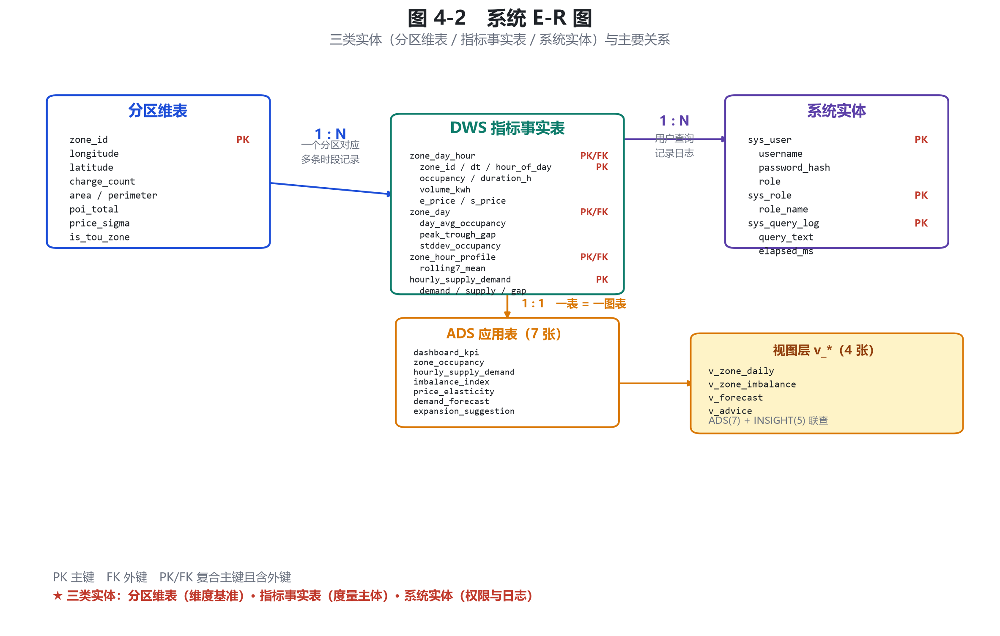

# 报告第三、四章 · 需求分析与系统概要设计（初稿）

> **主笔：彭忠燕（A 组）、苏静（B 组）**　|　**创建时间：2026-11-23**
> **状态**：初稿（2026-11-23）　|　**实测数字已由 A 岗 Python 路径回填**，见文末《实测数据附表》
> **事实源**：`docs/contracts/` 四份契约文件（数据字典 / 指标定义表 / 接口规范 / 数仓表结构规范）+ `docs/RUNBOOK.md`
> **目标字数**：第三章 2200 字 + 第四章 2500 字

---

# 第三章 需求分析

> **主笔：彭忠燕（A 组）、杨姗姗（D 组）**　|　**创建时间：2026-11-23**
> **状态**：初稿（2026-11-23）　|　**实测数字已由 A 岗 Python 路径回填**，见文末《实测数据附表》
> **本章定位**：把"充电桩到底缺在哪、缺多少"这一业务问题翻译成可实现、可验收的工程规格

---

## 3.1 需求分析目的

需求分析是软件工程中把业务诉求转化为可验证规格的关键环节。本章的目的有四：
其一，明确系统要解决的核心问题——在 275 个交通分区规模上识别充电供需的结构性错配，
并把"哪个分区、哪个时段、缺多少容量"量化出来；
其二，界定数据边界与口径边界，确认分析粒度落在**分区（traffic zone）**而非充电桩级，
避免出现"平均占用率很好看、但具体该建桩的地方说不清"的无效结论；
其三，识别三类使用者角色（系统管理员、运营人员、城市管理者）的差异化诉求，
并据此划定功能边界；
其四，为第四章的概要设计、第五章的详细实现与第六章的测试方案提供同一份验收基准。

---

## 3.2 系统的总体目标

本系统的总体目标是：**构建一条从原始数据到布点决策的完整数据链路，
使城市充电设施的供需失衡从"经验判断"变为"可量化、可追溯、可复现"的结论。**
围绕这一总目标，分解为八项子目标：

1. **数据可达**：以 12 个 CSV 为入口，建立从本地目录到 HDFS 的自动化增量采集通道，
   使原始数据不再依赖手工拷贝。
2. **口径统一**：把 12 项基础指标（M1–M12）与 4 个创新指标的公式、来源表、
   单位与边界条件固化在契约文件中，消除"同名不同义"。
3. **结构可用**：将 276 列宽表形态的原始时序数据，转换为可做多维聚合的长表，
   支撑分区 × 日 × 小时粒度的分析。
4. **质量可控**：对 6 项时序指标逐项执行越界与异常判定，
   清洗动作留痕、可追溯、可复核。
5. **空间可解释**：把 712,135 条 POI 落到 275 个分区上，
   使充电需求的城市功能成因具备可分析的数据基础。
6. **结论可比**：设计消除分区规模差异的归一化指标，
   使 4 个桩的分区与 446 个桩的分区可以在同一把尺子上比较。
7. **决策可用**：由分析结果直接生成带优先级的布点扩容建议清单，
   输出为运营方与规划部门可直接采用的结论文本。
8. **系统可复现**：提供一键部署脚本、端到端体检脚本与完整运行手册，
   使第三方无需原始数据也能重建 ADS 层并启动服务。

---

## 3.3 系统的可行性分析

### 3.3.1 技术可行性分析

**（1）数据规模决定了必须使用 Hadoop 生态而非 MySQL 单机**

本课题的数据规模并非"大到必须上分布式"，但其**结构形态**使得单机关系库难以承担：

| 维度 | 具体量级 | 对单机方案的影响 |
|---|---|---|
| 时序宽度 | 6 张时序表均为 `time` + **275 个分区列**，共 276 列 | 宽表无法按 `zone_id` 分组聚合，任何分析都要先转长，转换动作本身就是一次全量扫描 |
| 时序长度 | **4,344 个逐小时时点**（2022-09-01 ~ 2023-02-28，181 天） | 单表约 120 万个单元格，6 表合计约 717 万 |
| 长表化后规模 | 275 × 4,344 × 6 ≈ **717 万行** | 需反复扫描才能完成多轮迭代（价格标准差 → 分区类型 → 分组聚合） |
| POI 空间连接 | **712,135** 条 POI × 275 个分区 | 朴素笛卡尔积约 1.96 亿次距离计算，单机单线程不可接受 |
| 迭代轮次 | 电价 σ 反推 TOU 分区 → 失衡指数 → 分区类型分组 → 预测回测 | 每次迭代若都回读原始宽表，I/O 成倍放大 |

若强行用 MySQL 单机实现，只能把 275 列宽表**按分区竖切成 275 张窄表**，
再 UNION ALL 起来——这正是 Hive 的 `LATERAL VIEW stack()` 或 MapReduce 宽转长要做的事，
但 MySQL 没有原生等价物，只能靠存储过程或应用层拼装，代码量与维护成本急剧上升。
同时，712,135 条 POI 的空间连接在 MySQL 中只能靠逐行计算球面距离，
无法利用 Map 端广播分区中心点这一标准优化。

Hadoop 生态恰好覆盖了上述每一个痛点：

| 计算环节 | Hadoop 组件 | 解决的问题 |
|---|---|---|
| 增量采集 | **Flume 1.11**（taildir + checkpoint） | 12 个 CSV 各一条独立通道，断点续传 |
| 高可靠存储 | **HDFS 3.3.x** | 原始数据与数仓分层落地，副本容错 |
| 宽转长 / 质检 / 空间连接 | **MapReduce 3.3.x**（`WideToLong`、`DataQualityCheck`、`PoiZoneJoin` 三个作业） | 动态遍历 275 列，Map 端广播分区中心点 |
| 分层建模 | **Hive 4.0.x**（ODS/DWD/DWS/ADS） | 层间职责单一、可独立追溯 |
| 多维聚合 | **Spark SQL 3.4** | 一次读入长表完成 DWS 汇总与 ADS 指标计算 |
| 库间交换 | **Sqoop 1.4.7** | Hive ADS → MySQL 业务库 |

**（2）关键技术点均有可验证的工程结论**

宽表转长这一核心难点，本组已完成两种方案的对比实验：
使用 Hive `stack()` 需要硬编码全部 275 个列名，新增指标必须改 SQL 并重新编译；
使用 MapReduce 动态遍历列则可实现"新增指标零代码改动"。
该对比结论已写入《01-数据字典》与《04-数仓表结构规范》，说明关键技术路线可行且已选定。

**（3）技术栈成熟度与资源门槛可控**

Hadoop 3.3.6、Hive 4.0.0、Spark 3.4、Flume 1.11、Sqoop 1.4.7 均为 Apache 顶级项目的稳定版本；
后端 Spring Boot 3.2.5、前端 ECharts 5 亦为成熟选择。
部署形态为 Docker Compose 单机多容器，最低 8GB 内存 / 20GB 磁盘即可运行，
本组开发机上已完成全链路跑通记录（见 `docs/RUNBOOK.md`）。

**（4）技术风险与应对**

**表 3-1 技术风险与应对措施**

| 风险 | 影响 | 应对措施 |
|---|---|---|
| 宽表 276 列，代码难维护 | DWD 层开发受阻 | MapReduce 动态遍历列，新增指标零代码改动 |
| POI 空间连接量级大 | 计算耗时超预期 | Map 端广播 275 个分区中心点，避免笛卡尔积 |
| 集群环境配置复杂 | 演示失败 | Docker Compose 一键编排 + 三层自动降级启动模式 |
| 两条计算路径口径不一致 | 前后端数据对不上 | 同一份《02-指标定义表》约束双方，做 MySQL vs Hive 一致性校验 |
| 答辩现场网络或环境异常 | 无法演示 | 预录演示视频 + 预导出 ADS 静态数据作为兜底 |

> 结论：数据规模与迭代轮次共同决定了本系统采用 Hadoop 生态的必要性，
> 三个 MapReduce 作业与 Spark SQL 聚合均已在本地环境跑通，技术路线可行。

### 3.3.2 经济可行性分析

本课题在软件授权、数据获取、硬件部署三个方面的成本均为零或接近零：

**表 3-2 经济成本构成**

| 成本项 | 具体内容 | 金额 |
|---|---|---|
| 软件授权 | Hadoop / Hive / Spark / Flume / Sqoop / MySQL / Redis / Spring Boot / ECharts 全部为 Apache 2.0 或同类开源许可 | 0 |
| 数据获取 | UrbanEV 数据集采用 **CC0 1.0 Universal**（公共领域），GitHub 公开仓库直接下载 | 0 |
| 硬件 | 复用个人笔记本（8GB 内存 / 20GB 磁盘），以 Docker Compose 容器化部署，不采购服务器、不租云服务 | 0 |
| 人力 | 5 名成员的开发周期投入（无外部人力采购） | 时间成本 |
| 运维 | 课程作业原型，本地环境运行，无生产运维支出 | 0 |

需要说明的是，本系统刻意**不引入任何商业组件**：
不采购商业数据库、不调用付费大模型 API、不使用收费地图与 BI 工具。
连可视化所需的深圳分区 GeoJSON 与 ECharts 库也全部本地化到 `frontend/assets/` 与 `frontend/js/`，
保证答辩现场无外网也能正常渲染。
唯一的成本项是团队成员的时间投入，属课程作业的固有成本，不构成经济性障碍。

> 结论：软件与数据零授权成本、无额外硬件采购，软件开发在经济上完全可行。

### 3.3.3 操作可行性分析

系统采用 B/S 架构，用户通过浏览器访问，无需安装任何客户端。
针对三类角色分别评估操作可行性：

**（1）系统管理员**

负责部署与运维。日常操作路径为：
`bash scripts/download_data.sh`（拉取 12 个 CSV）→ `bash scripts/start_all.sh`（自动选择
full / app / native 三种启动模式）→ `bash scripts/smoke_test.sh`（端到端体检）→ 打开看板。
启动脚本内置三层自动降级策略，Docker 环境异常时自动回退到应用层模式。
《RUNBOOK》以"拿到文档的人 30 分钟内跑起系统"为编写目标，覆盖环境要求、部署流程、
数仓构建、应用部署与排错五个部分，管理员无需依赖开发人员即可完成部署。

**（2）运营人员**

是系统的主要使用者，日常关注"哪里缺桩、什么时候缺、该补多少"。
看板提供日期范围、时段、分区、电价类型四个维度的联动筛选，
首页 KPI 卡、热力图、失衡 TOP10、预测曲线与布点建议表构成一条完整的决策动线；
每一条扩容建议都附带完整中文句子（`reason` 字段），
可直接复制进工单，不需要自行解读数值。

**（3）城市管理者**

关注全市空间格局与规划依据，而非单点运营细节。
分区着色地图支持按聚类结果（紧张型 / 过剩型 / 稳定型 / 潜力型）整体着色，
双口径电量偏差与 POI 关联分析为其提供供需错配的成因解释。
系统提供 Excel / CSV 导出，结论可直接进入汇报材料。

**（4）共性的操作友好性约束**

- 全部 16 个 REST 接口为只读查询，无写操作，无需担心误操作破坏数据；
- 参数非法时返回 400 与明确的错误信息，前端不白屏、给出友好提示；
- ECharts 与 GeoJSON 已本地化，无外网依赖；
- 响应统一为 `{code, message, data, timestamp}`，前端只判断 `code === 200`，交互逻辑简单。

> 结论：三类角色均有明确、无学习成本的操作路径，操作可行性成立。

---

## 3.4 系统的功能需求分析

依据第二章梳理的角色需求与可行性结论，系统功能划分为**八个模块**。
下表逐模块给出功能描述、输入、输出与处理逻辑。

### 3.4.1 数据接入与采集模块

**功能描述**：把分散存放的 12 个原始 CSV 通过 Flume 增量采集入 HDFS，并完成采集结果的完整性校验。

**输入**：12 个 CSV（6 张时序宽表 + `inf` / `adj` / `distance` 3 张维表 + `poi` + 2 张气象表）。

**输出**：HDFS `/uev/raw/<数据集名>/` 下 12 个独立子目录，每个子目录内为按时间戳命名的分片文件。

**处理逻辑**：采用 Flume taildir source 监听本地目录，
**12 个 CSV 各配置一条独立的 source / channel / sink 通道**，避免多源写入同一目录；
channel 启用 file channel 保证断点续传，sink 写 HDFS 时保留 checksum 以便校验；
采集完成后用 `hdfs dfs -ls` 核对目录数与文件数，
并用 `bash scripts/verify_data.sh` 完成 36 项 SHA256 与行数校验。

### 3.4.2 数据仓库构建模块

**功能描述**：按 ODS–DWD–DWS–ADS 四层规范组织数据，是全系统的计算主干。

**输入**：HDFS 上的 12 个 CSV 原始文件。

**输出**：ODS 贴源宽表（每张 276 列）、DWD 长表与维表、DWS 汇总表、
ADS 应用表（一张表对应前端一张图表）。

**处理逻辑**：
① **ODS 贴源**：用 `hadoop/hive/gen_ddl.py` 从 CSV 表头自动生成 276 列的 DDL，
避免手写列名出错，宽表保持原貌不做任何加工；
② **DWD 宽转长**：运行 MapReduce 作业 `WideToLong`，
Mapper 动态遍历 275 个分区列，输出 `zone_id / hour_ts / hour_of_day / day_of_week / metric / value / is_zero`，
按 `dt`（`yyyy-MM-dd`）分区，约 717 万行；
③ **DWS 轻汇总**：用 Spark SQL 生成 `zone_day_hour`（分区 × 日 × 小时，9 字段）、
`zone_day`（分区 × 日，11 字段）与 `zone_hour_profile`（分区 × 小时画像），
并补充 `zone_cluster_features` 聚类特征宽表；
④ **ADS 应用层**：用 Spark SQL 计算 7 张核心应用表，
每张表严格对应前端的一张图表，字段与《02-指标定义表》一一对应；
创新点④ 的分区聚类结果表 `zone_cluster` 由 `zone_clustering.sql` 与
`ZoneClustering.scala` 另行产出。

### 3.4.3 数据质量检查模块

**功能描述**：在长表生成后对数据做系统化的质量体检，既产出清洗结果，也产出可复核的质量证据。

**输入**：`uev_dwd.zone_hour_metric` 长表、6 项指标的合法值域定义。

**输出**：`uev_dwd.dq_zone_stat` 质量画像表，字段含 `valid_cnt`（有效值个数）、
`zero_cnt`（零值个数）、`outlier_cnt`（越界值个数）、`total_cnt`（总单元格数）、
`valid_rate`（有效率）。

**处理逻辑**：执行 8 类质量规则，逐单元格判定：
占用率限定在 [0,1]、时长与电量非负、电价与服务费非负、零值单独打 `is_zero` 标记而不直接丢弃、
异常值按"先修复后丢弃、逐条记因"处理；
每个指标的越界阈值通过作业参数传入（如 `-D uev.metric.min=0 -D uev.metric.max=1`）。
**关键验收口径**：DWD 长表行数必须小于 ODS 对应单元格数，
二者比对是"清洗真实生效"的直接证据，也是第六章数据准确性测试的基准。

### 3.4.4 POI 空间连接与空间维表加工模块

**功能描述**：把没有分区标识的 POI 落到 275 个交通分区上，并整合出分析所需的分区综合维度表。

**输入**：`poi.csv`（**712,135** 条，含 `primary_types` 三类与 WGS84 经纬度）、
`inf.csv`（275 行，含分区中心点经纬度、`charge_count`、`area`、`perimeter`）。

**输出**：`uev_dwd.zone_poi_count`（分区 × 三类 POI 计数）、
`uev_dwd.dim_zone_info`（15 字段分区综合维表）。

**处理逻辑**：
① 空间连接由 MapReduce 作业 `PoiZoneJoin` 完成，
**Map 端加载并广播 275 个分区中心点坐标**，逐条 POI 计算球面距离并归入最近分区，
避免 712,135 × 275 的笛卡尔积；
② POI 按 `primary_types` 分为 lifestyle services、business and residential、
food and beverage services 三类分别计数，合计写入 `poi_total`；
③ 维表以 `TAZID = zone_id` **显式关联**（`inf.csv` 行序与时序表列序不一致，
按行号对齐会导致全部空间分析失真且极难发现）；
④ 同一张维表内用 `STDDEV_POP(e_price)` > 0.05 判定是否分时电价区，
写入 `is_tou_zone`、`price_std`、`price_peak`、`price_valley`、`price_gap`，
供创新指标②直接消费。

### 3.4.5 分析指标计算模块

**功能描述**：在 DWS 汇总表上计算 12 项基础指标与 4 个创新指标，是分析价值的核心载体。

**输入**：`uev_dws.zone_day_hour`、`uev_dws.zone_day`、`uev_dwd.dim_zone_info`、
`uev_dwd.zone_hour_metric`。

**输出**：12 项基础指标（M1–M12）与 4 个创新指标对应的 ADS 表。

**处理逻辑**：基础指标覆盖需求强度（M1）、全市同期基准（M2）、
平均与峰值占用率（M3、M4）、累计电量与平均时长（M5、M6）、
日内峰谷差与波动率（M7、M8）、POI 密度与桩密度（M9、M10）、
双口径电量偏差（M11）、峰谷电价差（M12）。
四个创新指标的计算逻辑如下：

- **创新点① 供需失衡指数**（落地表 `uev_ads.imbalance_index`）：
  需求份额 D(z,t) = demand(z,t) / Σdemand，运力份额 S(z,t) = charge_count(z) / Σcharge_count，
  失衡指数 I(z,t) = D(z,t) − S(z,t)。
  取值范围 [−1, 1]，实际约 [−0.02, 0.02]；I > 0 表示该分区该时段的供不应求程度高于全市结构。
  **设计意图**：消除分区规模差异（4 ~ 446 个桩），使不同规模的分区可横向比较。
- **创新点② 分时电价弹性**（落地表 `uev_ads.price_elasticity`）：
  先按电价时序标准差 σ 判定 TOU 区（σ > 0.05）与 FLAT 区，
  再计算 PEAK_RATIO（17–19 时平均占用率）− VALLEY_RATIO（0–6 时平均占用率），
  判读规则是 **ELASTICITY 越小表示峰谷被压得越平，削峰填谷效果越好**。
  该分析基于观测性关联，不作因果推断。
- **创新点③ 充电需求预测与布点扩容建议**（落地表 `uev_ads.demand_forecast`、`uev_ads.expansion_suggestion`）：
  采用"同 `day_of_week` 同 `hour_of_day` 均值 × 趋势因子 γ"的统计预测方法，
  前 174 天训练、后 7 天回测验证并报告 MAPE / MAE / RMSE 并与朴素基线对比；
  布点规则为 `建议新增桩数 = ⌈I_max(z) × charge_count(z) × 0.3⌉`，
  其中 0.3 为保守规划系数（一次规划不宜过大，分期建设更稳妥），优先级按 I_max 降序。
- **创新点④ 分区聚类画像**（落地表 `uev_ads.zone_cluster`）：
  以 Spark MLlib KMeans 对 275 个分区做 7 维特征聚类（k = 4），
  三个必写技术点为特征标准化（否则结果被量级最大的桩密度独占）、
  固定随机种子 `setSeed(42)` 保证可复现、用肘部法给出 k = 2~6 的 WCSS 曲线说明选 k = 4 的依据。
  **关键互证**：紧张型簇的平均失衡指数应显著高于其他簇，
  两种独立方法得到一致结论是本节最有说服力的部分。

### 3.4.6 在线服务与接口模块

**功能描述**：以 Spring Boot 提供 16 个 REST 接口，只读 MySQL 视图层，为前端与外部调用方提供数据服务。

**输入**：MySQL `uev_charge` 库的 `v_*` 视图与 `ads_*` / `insight_*` 明细表。

**输出**：统一响应结构的 JSON（`code` / `message` / `data` / `timestamp`）。

**处理逻辑**：
① 接口路径与出入参严格遵循《03-接口规范》，11 个核心接口（健康检查、KPI、
分区占用率、7 个图表类接口、数据字典）已固化完整示例；
② 支持 5 个公共查询参数：`startDate`、`endDate`、`hourRange`、`zoneId`、`priceType`；
③ Redis 缓存按接口类型分层设置 TTL（KPI 300 秒 / 分区占用率 600 秒 / 图表类 120 秒），
**缓存 key 必须包含全部筛选参数的哈希**，否则切换筛选条件会读到旧数据；
④ 全局异常处理器统一异常响应格式，避免堆栈信息泄露；
⑤ `region-count` 等配置项外置为 `application.yml` 中的环境相关参数；
⑥ 数据一致性保障：同一指标在 MySQL 的查询结果必须等于 Hive 直查结果。

### 3.4.7 可视化展示模块

**功能描述**：以 ECharts 5 构建深色主题的决策看板，把接口数据渲染为 6 个页面共 10 张图表。

**输入**：16 个 REST 接口返回的 JSON。

**输出**：KPI 指标卡、分区热力图 / 地图、24 小时供需曲线、失衡 TOP10 柱状图、
TOU/FLAT 双曲线、预测值与实际值对比折线图、布点建议表格、双口径电量对比图、
POI 关联散点图、分区聚类地图。

**处理逻辑**：前端只调用后端接口、不直接访问数据库，保证口径唯一；
四个筛选维度的变更触发所有图表联动刷新；
ECharts 与深圳分区 GeoJSON 均本地化存放，无 CDN 依赖；
接口失败时显示占位提示而非白屏；
布点建议表与 KPI 概览支持 Excel / CSV 导出；
`reason` 字段为完整中文句子，直接展示不做二次拼装。

### 3.4.8 布点扩容决策建议模块

**功能描述**：把失衡指数与预测误差结论，转换为运营方可直接执行的扩容清单。

**输入**：`uev_ads.imbalance_index`（取分区的 I_max 与对应 `hour_of_day`）、
`uev_ads.demand_forecast`（MAPE 与回测值）、`uev_dwd.dim_zone_info`（`charge_count`）。

**输出**：分区级建议清单，含 `zoneId`、`currentPiles`、`suggestedPiles`、
`priority`、`reason`（完整中文句子）、`avgOccupancy`、`peakGap`。

**处理逻辑**：按 I_max 降序生成优先级（1 = 最高）；
建议新增桩数按 ⌈I_max × charge_count × 0.3⌉ 向上取整，
`suggestedPiles` 语义为"**新增**数量"而非总数，避免被误读；
`reason` 由模板生成完整中文句子并附上失衡指数与现有桩数，
使运营人员无需理解公式即可转成工单；
清单同时给出该分区的平均占用率与峰值缺口，供人工复核。

---

## 3.5 系统主要用例分析

系统识别出三类角色共 **14 个系统用例**，覆盖数据运维、分析决策与规划研判三类场景。
表 3-3 给出用例描述表。

**表 3-3 系统用例描述表**
| 用例编号 | 用例名称 | 参与者 | 前置条件 | 基本流 | 后置条件 | 异常流 |
|---|---|---|---|---|---|---|
| UC-01 | 数据采集与入库校验 | 系统管理员 | 12 个 CSV 已下载至本地目录 | ① 执行采集脚本<br>② Flume 按 12 条通道写入 HDFS<br>③ 校验目录数、文件数与行数<br>④ 登记校验结果 | HDFS `/uev/raw/` 下 12 个子目录就绪 | 文件数或行数不符时中止后续步骤并提示重新下载 |
| UC-02 | 数仓全链路重建 | 系统管理员 | 采集已完成，脚本与镜像可用 | ① 生成 276 列 DDL 并建 ODS 表<br>② 运行三个 MR 作业<br>③ Spark SQL 计算 DWS / ADS<br>④ Sqoop 导出 MySQL<br>⑤ 体检脚本核验 | 四层表齐备且 DWD 行数小于 ODS | 作业异常时按《RUNBOOK》排错表定位；必要时全量重建 |
| UC-03 | 查看全市运行概况 | 运营人员 / 城市管理者 | ADS 层已产出并导入 MySQL | ① 打开看板首页<br>② 系统加载 KPI 指标卡与 10 张图表<br>③ 用户查看全市整体运行状况 | 无 | 接口失败时显示占位提示与排查指引 |
| UC-04 | 多维筛选分析结果 | 全部角色 | 系统已部署 | ① 用户选择日期范围、时段、分区或电价类型<br>② 提交查询<br>③ 后端按参数哈希查缓存，未命中则读 MySQL<br>④ 全部图表联动刷新 | 查询结果写入查询日志 | 参数非法时返回 400 与明确错误信息 |
| UC-05 | 识别供需失衡分区 | 运营人员 | `uev_ads.imbalance_index` 已生成 | ① 打开失衡指数 TOP10 图表<br>② 系统按失衡指数降序展示分区及需求份额、运力份额<br>③ 用户在地图上定位分区位置 | 无 | 缓存 TTL 内参数未变时返回既有结果并标注命中缓存 |
| UC-06 | 评估分时电价引导效果 | 运营人员 / 城市管理者 | `uev_ads.price_elasticity` 已生成 | ① 打开 TOU / FLAT 双曲线图<br>② 系统展示两组逐小时占用率曲线与分组统计<br>③ 用户比较两组峰谷差 | 无 | 分组样本为空时提示该阈值下无匹配分区 |
| UC-07 | 获取需求预测与误差评估 | 运营人员 / 数据分析师 | 预测模型已训练并完成回测 | ① 用户请求预测数据<br>② 系统返回预测值、实际值与 MAPE<br>③ 用户对比曲线评估精度 | 无 | MAPE 超过阈值时前端提示改用"近 7 天同小时均值"口径 |
| UC-08 | 查看分区聚类画像 | 城市管理者 / 数据分析师 | `uev_ads.zone_cluster` 已生成 | ① 打开聚类地图<br>② 系统按簇着色 275 个分区<br>③ 用户查看各簇特征雷达与规模 | 无 | 簇规模出现极端分布时提示重新检查标准化与种子设置 |
| UC-09 | 生成布点扩容建议 | 运营人员 / 城市管理者 | 失衡指数与预测结果均已生成 | ① 打开布点扩容看板<br>② 系统展示按优先级排序的分区清单<br>③ 用户依据 `reason` 制定扩容计划 | 无 | 建议桩数计算所需的 `charge_count` 缺失时跳过该分区并记日志 |
| UC-10 | 导出决策清单 | 运营人员 / 城市管理者 | 看板数据已加载 | ① 用户点击导出<br>② 后端生成 Excel / CSV 文件<br>③ 浏览器下载 | 导出记录写入操作日志 | 文件生成失败时返回错误并保留当前筛选条件 |
| UC-11 | 查看数据字典与指标口径 | 数据分析师 / 系统管理员 | 契约文件已入库 | ① 用户打开"数据源说明"页<br>② 系统展示 12 个 CSV 的指标名、单位、行数、粒度 | 无 | 字典接口异常时提示以《01-数据字典》为准 |
| UC-12 | 双口径电量偏差分析 | 数据分析师 | `uev_ads` 与 DWD 长表均可用 | ① 用户打开双口径对比图<br>② 系统返回各分区的两套电量与偏差率<br>③ 用户定位大功率桩占比高的分区 | 无 | 某分区 `volume` 为 0 时偏差率返回 NULL 而非除零异常 |
| UC-13 | 系统健康检查与故障排查 | 系统管理员 | 服务已启动 | ① 请求 `/api/health`<br>② 系统返回各组件状态与分区总数<br>③ 管理员据此判断故障位置 | 无 | MySQL 或 Redis 状态异常时在 `components` 中标记 DOWN |
| UC-14 | 账号与角色权限管理 | 系统管理员 | `sys_user` / `sys_role` 表已建 | ① 管理员新增或调整用户角色<br>② 系统记录操作日志<br>③ 管理员按角色分配数据访问范围 | 操作日志新增一条记录 | 权限冲突时拒绝写入并返回明确原因 |

**用例图说明**：

用例图以 UML 用例图形式绘制，建议包含以下要素：

- **参与者（Actor）**：系统管理员、运营人员、城市管理者三个外部参与者，
  另可补充"定时任务"作为非人工参与者，对应 UC-01 采集与 UC-02 重建两个自动化用例；
- **系统用例边界**：以矩形框界定 14 个系统用例，
  排布为三行——上行为数据运维类（UC-01、UC-02、UC-13、UC-14），
  中行为分析浏览类（UC-03、UC-04、UC-05、UC-06、UC-11、UC-12），
  下行为决策输出类（UC-07、UC-08、UC-09、UC-10）；
- **关联关系**：三个参与者分别与相关用例画无向关联线——
  系统管理员关联 UC-01、UC-02、UC-11、UC-13、UC-14；
  运营人员关联 UC-03、UC-04、UC-05、UC-06、UC-07、UC-09、UC-10；
  城市管理者关联 UC-03、UC-04、UC-06、UC-08、UC-09、UC-10；
- **包含关系（«include»）**：UC-03（查看全市概况）与 UC-04（多维筛选）
  均 «include» UC-04 的查询能力；UC-09（布点建议）«include» UC-05（识别失衡分区）
  与 UC-07（预测与误差），因为建议清单的生成同时依赖失衡指数与分区桩数；
- **扩展关系（«extend»）**：UC-04 的筛选能力 «extend» UC-03 / UC-05 / UC-06 / UC-08，
  表示"可选地按条件筛选"；UC-10（导出）«extend» UC-09 与 UC-03。

> 结论：14 个用例覆盖三类角色的全部核心场景，
> 用例之间通过 include / extend 复用查询与决策能力，边界清晰无冗余。

---

## 3.6 整体数据流分析

系统的整体数据流按四层组织，逐层收敛、逐层增值。
图 3-1 以文字分层图给出该结构的完整描述。

**图 3-1 系统整体数据流分层结构图**



> 结论：数据从 12 个 CSV 出发，经采集、治理、建模、聚合、服务五个环节，
> 最终在 MySQL `uev_charge` 库汇合并以 16 个 REST 接口对外供给，链路唯一出口明确。

**DFD 各级应画的内容说明**：

**（1）顶层图（Context Diagram）**

只画三个外部实体与系统整体边界：
外部实体为 **运营人员**、**城市管理者**、**系统管理员**（以及作为数据源的 **UrbanEV 数据集**）。
系统内部只画一个加工过程"城市充电桩数据分析系统"，
画出四条主数据流：数据集 → 系统的原始数据输入流、系统的分析结果输出流（分别指向两类业务角色）、
系统 → 管理员的运维指令流。顶层图不出现任何内部细节，不出现文件格式与表名。

**（2）0 层图（Level 0 DFD）**

把系统内部展开为四个加工过程，对应本节图 3-1 的四层：

| 加工过程编号 | 名称 | 输入流 | 输出流 | 内部数据存储 |
|---|---|---|---|---|
| P1 | 数据采集与落地 | 原始 CSV | 分片文件 | D1：HDFS `/uev/raw/` |
| P2 | 数据清洗与空间连接 | 分片文件 | 清洗后长表、分区维表、质量画像 | D2：Hive ODS / DWD |
| P3 | 分层建模与指标计算 | 清洗后长表、分区维表 | 汇总表、应用指标表 | D3：Hive DWS / ADS |
| P4 | 在线服务与决策输出 | 应用指标表 | 图表数据、建议清单、导出文件 | D4：MySQL `uev_charge`、Redis |

0 层图上要画出 P2 → P3 → P4 的串行主干，以及 P3 → P4 的第二条并行支线
（E 组直接由原始 CSV 计算创新指标并直插 `insight_*`），并注明"两条路径在 MySQL 视图层汇合"。

**（3）1 层图（Level 1 DFD）**

把上表四个加工过程各展开一层：
P1 展开为"通道配置 → taildir 监听 → 落盘 → 校验"；
P2 展开为"宽转长 → 规则判定 → 空间连接 → 维表整合"；
P3 展开为"DWS 汇总 → 基础指标计算 → 创新指标计算 → ADS 落表"；
P4 展开为"视图查询 → 缓存判定 → 响应组装 → 图表渲染 → 导出"。
1 层图上应出现分区日期 `dt` 与分区编号 `zone_id` 两个关键数据字典项。

**（4）2 层图**

仅对 P2（数据清洗与空间连接）与 P4（在线服务与决策输出）细化，
因为这两处是本系统的技术难点与业务价值核心；
其余加工过程在 1 层图上表示即可，避免图形过载。

**外部实体与数据字典说明**：
外部实体共 4 个——运营人员、城市管理者、系统管理员、UrbanEV 数据集；
核心数据字典项 5 个——`zone_id`（分区编号）、`hour_ts`（小时时间戳）、
`dt`（日期分区键）、`metric`（指标名）、`value`（指标值）。
这 5 项在 P2 与 P3 之间流转，是长表结构的核心承载，也是后续联查的唯一凭据。

---

## 3.7 系统的非功能性需求分析

### 3.7.1 性能需求

**表 3-4 性能需求与实现方式**

| 编号 | 需求项 | 指标要求 | 实现方式 |
|---|---|---|---|
| NF-P-01 | 首页聚合查询响应时间 | ≤ 500 ms | Redis 缓存首页 KPI 聚合结果，TTL 300 秒 |
| NF-P-02 | 明细指标查询响应时间 | ≤ 1 s | MySQL 索引优化（`zone_id`、`hour_of_day`、`rank_no`） |
| NF-P-03 | 复杂图表查询响应时间 | ≤ 2 s | ADS 层预聚合 + 图表类接口缓存，TTL 120 秒 |
| NF-P-04 | Hive 四层全链路计算耗时 | ≤ 30 min | Spark on `local[*]` + 按 `dt` 分区裁剪 |
| NF-P-05 | 缓存命中率 | ≥ 80% | 缓存 key 含全部筛选参数哈希，热门查询条件重复度高 |
| NF-P-06 | 并发查询能力 | 支持 50 个并发请求 | 无状态服务 + 连接池 + Redis 缓存分流 |

> 结论：六项性能指标均给出了明确的量化门槛与对应的实现手段，
> 实测值由 B / E / D 岗产出后回填。

### 3.7.2 可靠性需求

- **NF-R-01 数据完整性**：采集环节提供校验脚本，验证 12 个文件的存在性与行数
  （时序表 4,344 行、`inf` 275 行、`poi` 712,135 行）；
- **NF-R-02 清洗可验证**：四层表逐层 `COUNT(*)` 对比，
  要求 **DWD 行数小于 ODS 对应单元格数**，以证明清洗真实生效；
- **NF-R-03 服务健壮性**：全局异常处理器统一异常响应格式，避免异常堆栈泄露；
  MySQL 与 Redis 连接均配置超时与重连；
- **NF-R-04 断点可续**：Flume 使用 file channel 保存消费位点，
  作业中断后从上次位点继续，不重复写入也不丢数据；
- **NF-R-05 口径可复核**：任一指标在 MySQL 的查询结果必须等于 Hive 直查结果，
  不一致时先改契约再改实现，并在 `CHANGELOG.md` 登记；
- **NF-R-06 降级可兜底**：Docker 不可用时可只启动应用层直连已导入的 MySQL 静态数据。

### 3.7.3 可维护性与可扩展性需求

- **NF-M-01 分层解耦**：数据接入、数仓计算、分析建模、服务呈现四层职责清晰，
  层间通过《04-数仓表结构规范》约定的表结构衔接；
- **NF-M-02 契约驱动**：四份契约文件作为唯一事实源，
  任何口径变更必须先改契约、登记 CHANGELOG，再由下游拉取生效，
  `scripts/check-contracts.sh` 自动校验契约与实现的一致性；
- **NF-M-03 配置外置**：数据库地址、缓存配置、分区总数等全部通过
  `application.yml` 与环境变量注入，切换环境无需修改代码；
- **NF-M-04 指标可扩展**：ADS 层新增指标只需新增 SQL 与表，
  不影响已有模块与已有接口；
- **NF-M-05 宽表可扩展**：宽表转长由 MapReduce 动态遍历列实现，
  新增指标文件不需要改动 Java 代码；
- **NF-M-06 文档完备**：提供数据字典、指标定义表、接口规范、数仓表结构规范四份契约
  与完整运行手册，第三方可在独立环境中复现系统。

### 3.7.4 安全性需求

- **NF-S-01 注入防护**：所有数据库访问使用参数化查询，杜绝 SQL 注入；
- **NF-S-02 凭证管理**：数据库口令、缓存口令通过配置文件与环境变量注入，
  **不硬编码在源码中**，且不随数据文件进入交付包；
- **NF-S-03 信息泄露防护**：全局异常处理器只返回业务级错误码与提示文案，
  不向前端返回异常堆栈与 SQL 片段；
- **NF-S-04 权限控制**：系统提供 `sys_user` / `sys_role` 两张表承载账号与角色，
  区分管理员、分析人员两类角色，按角色限定数据访问范围；
- **NF-S-05 传输安全**：当前为本地 HTTP 部署，
  生产化部署须引入 HTTPS 传输加密与操作审计；
- **NF-S-06 只读优先**：16 个对外接口全部为查询接口，无写操作，
  从接口层面缩小攻击面。

> 结论：四类非功能需求共 22 条（性能 6 / 可靠性 6 / 可维护性 6 / 安全性 6），
> 均为可测量或可验证的具体条目，构成第六章测试方案的直接依据。

---

## 3.8 本章小结

本章从需求分析目的出发，明确了系统的总体目标——把充电设施的供需错配从经验判断
转化为可量化、可追溯、可复现的结论，并分解为数据可达、口径统一、结构可用、质量可控、
空间可解释、结论可比、决策可用、系统可复现八项子目标。

在可行性论证上，技术可行性方面以 276 列宽表、4,344 个逐小时时点、717 万行长表化规模
与 712,135 条 POI 空间连接为依据，论证了采用 Hadoop 生态而非 MySQL 单机的必要性，
并逐项映射了 Flume、HDFS、MapReduce、Hive、Spark SQL、Sqoop 的对应职责；
经济可行性方面确认软件与数据零授权成本、无额外硬件投入；
操作可行性方面针对系统管理员、运营人员、城市管理者三类角色分别给出了操作路径。

功能需求按八个模块展开，覆盖采集接入、数仓构建、质量检查、POI 空间连接与维表加工、
指标计算、在线服务、可视化展示与布点决策建议，并明确 4 个创新指标的计算逻辑与业务价值。
用例分析给出 14 个系统用例的完整描述与用例图绘制方案；
数据流分析给出四层数据流结构与 DFD 四级绘制的具体内容；
非功能性需求提出性能、可靠性、可维护性、安全性四类共 22 条可测条目。

本章形成的需求规格，将直接指导第四章的系统概要设计与第五章的详细实现。

> **本章由 彭忠燕 / 杨姗姗 负责**

---

# 第四章 系统概要设计

> **主笔：苏静（B 组）**　|　**创建时间：2026-11-23**
> **状态**：初稿（2026-11-23）　|　**实测行数与耗时已由 A 岗 Python 路径回填**，见文末《实测数据附表》
> **本章定位**：把第三章的需求规格落成"模块怎么分、数据怎么存、模块之间怎么对话"的实现级蓝图

---

## 4.1 概要设计的目的

概要设计是需求分析通向详细设计之间的桥梁，承担三项任务。
第一，**划定系统边界**：确定系统由哪些功能模块构成、每个模块的职责边界在哪里、
模块之间的调用方向是什么，从而避免职责重叠与推诿。
第二，**确定数据骨架**：设计数据库的层次结构、实体之间的关联关系与视图组织方式，
使数据结构能够支撑第三章提出的全部功能需求与查询场景。
第三，**约定对外契约**：确定各模块的输入输出格式与接口形式，
使第五章的详细实现可以并行推进而互不阻塞——
这也是本组五名成员能在同一套契约下分工编码的前提。

本章的设计遵循三条原则：
**层间职责单一**（ODS 只贴源、DWD 只清洗与补维、DWS 只汇总、ADS 只出应用指标）、
**表与图表一一对应**（ADS 层一张表只服务前端一张图）、
**读接口与写表解耦**（后端接口只读视图，不直接触碰明细表），
这三条原则在下文的模块设计与视图设计中会反复体现。

---

## 4.2 系统总体功能设计

### 4.2.1 总体功能结构

依据第三章的八个功能模块与可行性结论，系统总体功能划分为**五个一级模块**，
每个一级模块下设若干二级模块。

**图 4-1 系统总体功能结构图**



> 结论：系统由 5 个一级模块、19 个二级模块构成，
> 覆盖"采集—建模—分析—服务—保障"完整链路，二级模块与第三章的八个功能模块一一对应、无遗漏。

### 4.2.2 模块职责对照

**表 4-1 一级模块职责对照表**

| 模块 | 核心职责 | 主要输入 | 主要输出 | 负责岗位 |
|---|---|---|---|---|
| MOD-1 数据接入模块 | 把 12 个 CSV 从本地目录自动、可断点地采集进 HDFS | 12 个原始 CSV | HDFS `/uev/raw/` 下 12 个子目录 | B（苏静） |
| MOD-2 数据仓库模块 | 建成 ODS–DWD–DWS–ADS 四层数仓，完成宽转长、清洗、空间连接与汇总 | HDFS 原始分片 | 16 张 Hive 建模表 | B（苏静） |
| MOD-3 指标分析模块 | 计算 12 项基础指标与 4 个创新指标，产出分析结论 | DWS 汇总表、DWD 长表与维表 | ADS 应用表、`insight_*` 洞察表 | E（姬婷婷） |
| MOD-4 服务与可视化模块 | 把结论通过 16 个 REST 接口与看板呈现给三类角色 | MySQL `uev_charge` | JSON 响应、图表、导出文件 | D（杨姗姗）/ C（贺欢欢） |
| MOD-5 运维保障模块 | 保证系统可部署、可体检、可复现、口径不漂移 | 脚本、契约、镜像 | 部署编排、体检报告、CHANGELOG | A（彭忠燕） |

> 结论：五个模块的输入输出形成闭环，M2 的输出是 M3 的输入、M3 的输出是 M4 的输入，
> 无模块既是上游又是下游的旁路依赖，模块边界清晰可并行开发。

---

## 4.3 各功能模块的概要设计

### 4.3.1 数据接入模块的概要设计

**模块描述**：负责把散落在本地目录的 12 个原始 CSV，完整、可校验、可重放地搬进 HDFS，
是整个系统的入口。

**输入输出**：

| 项 | 内容 |
|---|---|
| 输入 | `data/raw/` 下 12 个 CSV（6 张时序宽表 + `inf` / `adj` / `distance` / `poi` + 2 张气象表） |
| 输出 | HDFS `/uev/raw/<数据集名>/` 下 12 个独立子目录内的分片文件；`verify_data.sh` 的校验报告 |
| 中间态 | Flume file channel 的消费位点文件（断点续传用） |

**处理流程**：

```
① 环境探测：find_data.sh 按 UEV_DATA_DIR → data/raw/ → ../数据/UrbanEV/ 顺序自动定位数据目录
       ↓
② 完整性校验：verify_data.sh 执行 36 项 SHA256 与行数校验
       ├── 全部通过 → 进入 ③
       └── 任一失败 → 报告缺失文件并提示重下，终止流程
       ↓
③ 增量采集：Flume taildir source 监听目录变化
       ├── 12 个 CSV 各一条独立通道（source / channel / sink 三段一一对应）
       ├── file channel 保存消费位点 → 支持断点续传
       └── HDFS sink 写入 /uev/raw/<数据集名>/，保留 checksum
       ↓
④ 采集校验：hdfs dfs -ls 核对 12 个子目录与分片数，
   hdfs dfs -cat 抽查首行表头是否为 time + 275 个分区列
       ↓
⑤ 输出采集结论（目录数 / 分片数 / 校验状态），供 M2 消费
```

**与其他模块的接口**：
向上（对 M2）以 **HDFS 路径约定** 为接口——
`/uev/raw/<数据集名>/` 下 12 个子目录与 Hive 的 ODS 贴源表一一对应，
Hive 建表脚本直接指向这些路径，不做路径转换；
向下（对 M5）以 **采集日志与位点文件** 为接口，
位点文件同时充当 M5 冒烟测试判断"是否需要重新采集"的依据。

### 4.3.2 数据仓库模块的概要设计

**模块描述**：本模块是系统的计算主干，承担从原始宽表到可用分析结果的全部加工工作。

**输入输出**：

| 项 | 内容 |
|---|---|
| 输入 | M1 产出的 HDFS 分片文件（12 个子目录） |
| 输出 | ODS 贴源表（脚本自动生成 DDL）+ DWD 4 张 + DWS 4 张 + ADS 8 张加工层表 |
| 关键约束 | 分区键统一为 `dt`（`yyyy-MM-dd`）；长表化后行数约 275 × 4,344 × 6 ≈ 717 万行 |

**处理流程**：

```
① ODS 贴源：python3 hadoop/hive/gen_ddl.py 从 CSV 表头自动生成 276 列 DDL
   → hdfs dfs -put → beeline -f 建表 → LOAD DATA INPATH 装载
   ⚠️ LOAD DATA INPATH 是移动不是复制，须先 put 到临时目录再装载
       ↓
② DWD 宽转长：hadoop jar uev-mr.jar com.uev.mr.WideToLong
   /uev/raw/occupancy/ → /uev/dwd/long/occupancy
   -D uev.metric.name=occupancy
   → Mapper 动态遍历 275 列 → (zone_id, hour_ts, hour_of_day, day_of_week, metric, value, is_zero)
   ⚠️ 6 个指标各执行一次，输入目录与 uev.metric.name 同时改
       ↓
③ DWD 质量检查：hadoop jar uev-mr.jar com.uev.mr.DataQualityCheck
   -D uev.metric.min=0 -D uev.metric.max=1
   → 产出 dq_zone_stat（valid_cnt / zero_cnt / outlier_cnt / total_cnt / valid_rate）
   ⚠️ 验收口径：DWD 行数 < ODS 单元格数，证明清洗真实生效
       ↓
④ 空间连接与维表：hadoop jar uev-mr.jar com.uev.mr.PoiZoneJoin
   /uev/raw/poi/ → /uev/dwd/zone_poi_count -D uev.zone.info.path=/uev/raw/inf/
   → Map 端广播 275 个分区中心点，Haversine 距离归入最近分区
   → Spark SQL 整合出 dim_zone_info（15 字段，含 is_tou_zone / price_std / price_gap）
       ↓
⑤ DWS 汇总：spark-sql --master local[*] -f ads_metrics.sql
   → zone_day_hour（分区×日×小时）/ zone_day（分区×日）/ zone_hour_profile（分区×小时）
   → zone_cluster_features（7 维聚类特征宽表）
       ↓
⑥ ADS 产出：同一份 SQL 继续计算 7 张 ADS 表（dashboard_kpi / zone_occupancy /
   hourly_supply_demand / imbalance_index / price_elasticity / demand_forecast /
   expansion_suggestion），并由 zone_clustering.sql + ZoneClustering.scala 产出 zone_cluster
       ↓
⑦ 导出 MySQL：sqoop export --hcatalog-table uev_ads.xxx --hcatalog-database uev_ads -m 1
   ⚠️ Hive TIMESTAMP → MySQL 用 VARCHAR(30) 接收；connector 需 8.x 否则连 MySQL 8 报 query_cache_size
```

**与其他模块的接口**：
向上（对 M1）以 **HDFS 路径 + Flume 通道命名** 为接口；
向下（对 M3）以 **《04-数仓表结构规范》中的表名与字段名** 为接口——
M3 的所有 SQL 直接引用 `uev_dws.zone_day_hour`、`uev_dwd.dim_zone_info` 等表，
不复制粘贴数据，避免口径漂移；
横向（对 M5）以 **建表 9 步检查清单** 为接口，每一步都有明确的验收命令与期望输出。

### 4.3.3 指标分析模块的概要设计

**模块描述**：把数仓中的明细与汇总，转化为可解读、可比较、可决策的指标与结论。

**输入输出**：

| 项 | 内容 |
|---|---|
| 输入 | `uev_dws.zone_day_hour`、`uev_dws.zone_day`、`uev_dwd.dim_zone_info`、`uev_dwd.zone_hour_metric` |
| 输出 | 12 项基础指标 + 4 个创新指标；ADS 层 8 张表；`insight_*` 5 张洞察表 |
| 关键约束 | 两条路径并行——E 组用 pandas 直接从 CSV 复算并以 pymysql 直插 `insight_*`，不被 M2 的 Sqoop 排期卡住 |

**处理流程**：

```
① 基础指标层（M1–M12）
   需求强度 M1 = duration_h / charge_count      全市同期基准 M2 = Σduration / Σcharge_count
   平均占用率 M3 / 峰值占用率 M4                 累计电量 M5 / 平均时长 M6
   日内峰谷差 M7 = MAX(occ) − MIN(occ)           占用率波动率 M8 = STDDEV_POP(occ)
   POI 密度 M9 / 桩密度 M10                      双口径电量偏差 M11 / 峰谷电价差 M12
       ↓
② 创新点① 供需失衡指数
   D(z,t) = demand(z,t) / Σ demand    S(z,t) = charge_count(z) / Σ charge_count
   I(z,t) = D(z,t) − S(z,t)   → uev_ads.imbalance_index（正负值均须出现）
       ↓
③ 创新点② 分时电价弹性
   σ_price(z) = STDDEV_POP(e_price) > 0.05 → TOU 区，否则 FLAT 区
   ELASTICITY = AVG(occ | 17≤h≤19) − AVG(occ | 0≤h≤6)   → 值越小，削峰效果越好
   ⚠️ 结论只写观测性关联，不作因果推断
       ↓
④ 创新点③ 需求预测与布点建议
   基础值 = AVG(volume | 同 day_of_week 同 hour_of_day)   γ = AVG(近7天) / AVG(全期)
   predict = 基础值 × γ
   回测：前 174 天训练（2022-09-01~2023-02-21），后 7 天验证（02-22~02-28），报告 MAPE/MAE/RMSE
   建议新增桩数 = ⌈I_max(z) × charge_count(z) × 0.3⌉，优先级按 I_max 降序（1 = 最高）
       ↓
⑤ 创新点④ 分区聚类画像
   特征向量 X(z) = [avg_occupancy, peak_valley_gap, occupancy_std, avg_duration,
                    poi_density, pile_density, price_std]   （7 维）
   标准化 → setSeed(42) → 肘部法在 k=2~6 中选出 k=4 → KMeans → uev_ads.zone_cluster
   互证：紧张型簇的平均失衡指数应显著高于其他簇
       ↓
⑥ 结论落表：Hive ADS（供 B 走 Sqoop）+ MySQL insight_*（E 直插），两路口径按同一份
   《02-指标定义表》对齐，并在报告 6.3 节做 MySQL vs Hive 一致性校验
```

**与其他模块的接口**：
向上（对 M2）以 **表名与字段名** 为接口，只读不写数仓；
向下（对 M4）以 **ADS 表 + `insight_*` 表** 为接口，
其中 ADS 表供 `ads_*` 落地、`insight_*` 供视图联查，两者在视图层汇合；
横向（对 M5）以 **验收标准** 为接口——
《02-指标定义表》为每个创新指标写明验收口径（如"TOP10 应包含 CBD 类分区"），
冒烟测试按此逐条核对。

### 4.3.4 服务与可视化模块的概要设计

**模块描述**：把 M3 的结论以标准化接口与可视化看板的形式交付给三类使用者。

**输入输出**：

| 项 | 内容 |
|---|---|
| 输入 | MySQL `uev_charge` 的 4 张视图 `v_zone_daily` / `v_zone_imbalance` / `v_forecast` / `v_advice` |
| 输出 | 16 个 REST 接口的 JSON 响应；看板 6 页 10 图；Excel / CSV 导出文件 |
| 关键约束 | 接口只读视图，不直接访问明细表；`avgOccupancy` 返回原始比例，由前端 ×100 转百分比 |

**处理流程**：

```
① 请求进入：Spring Boot Controller 接收 GET 请求，统一前缀 /api
   → GlobalExceptionHandler 兜底，异常统一转为 {code, message, data, timestamp}
       ↓
② 参数校验：5 个公共可选参数 startDate / endDate / hourRange / zoneId / priceType
   → 非法参数返回 400 与明确提示，不吞异常
       ↓
③ 缓存判定：以全部筛选参数的哈希构造 key
   key = uev:{类型}:{name}:{hash}
   ├── 命中 → 直接返回缓存结果（TTL：KPI 300s / 分区占用率 600s / 图表 120s）
   └── 未命中 → 查 MySQL 视图 → 回填缓存 → 返回
   ⚠️ hash 必须覆盖全部筛选参数，否则改条件会拿到旧数据
       ↓
④ 视图联查：ads_*（B 的离线管道）与 insight_*（E 的探索性分析）在 v_* 视图层 JOIN
       ↓
⑤ 响应组装：字段名与《03-接口规范》完全一致（大小写敏感）
       ↓
⑥ 前端渲染：ECharts 5 本地化渲染，四个筛选维度联动刷新全部图表
   → 布点建议表与 KPI 概览支持 Excel / CSV 导出
```

**与其他模块的接口**：
向上（对 M3）以 **《03-接口规范》的路径与出入参** 为接口，11 个核心接口的示例已在契约中固化；
向下（对 M5）以 **Actuator 健康检查与查询日志** 为接口，
`/api/health` 返回 mysql / redis 组件状态与分区总数（`uev.data.region-count` 配置为 275）。

### 4.3.5 运维保障模块的概要设计

**模块描述**：保证系统"装得上、跑得起、查得出、别人也复现得了"。

**输入输出**：

| 项 | 内容 |
|---|---|
| 输入 | 仓库源码、契约文件、Docker 镜像、本地 12 个 CSV |
| 输出 | 可用的运行实例、体检报告、变更记录、交付包 |
| 关键约束 | 数据不进 Git（129MB），以脚本可再生；交付包不含明文密码与原始 CSV |

**处理流程**：

```
① 部署编排：docker compose --profile full up -d
   → start_all.sh 自动探测环境并选择 full / app / native 三种模式
   → 三层降级：集群起不来 → 只起应用层；应用层起不来 → 导出演示视频兜底
       ↓
② 初始化数仓：gen_ddl.py → 建库建表 → Flume 采集 → 三个 MR 作业 → Spark SQL → Sqoop export
       ↓
③ 启动应用：backend（8080）与 frontend（Nginx 反代到 /api）就绪
       ↓
④ 端到端体检：smoke_test.sh 分 6 组检查
   ① 数据文件 12 个 CSV   ② Hive 四层表有数据且 DWD < ODS
   ③ MySQL 业务表有数据   ④ 后端接口全部 200
   ⑤ Redis 连接正常       ⑥ 契约一致性 0 处冲突
       ↓
⑤ 契约治理：check-contracts.sh 扫描"契约定义 ↔ 建表脚本 ↔ Controller ↔ 计算脚本"四处一致性；
   口径变更走"改契约 → 登记 CHANGELOG → 下游 pull"的流程
       ↓
⑥ 交付打包：DDL 全集 + 每张 MySQL 表前 100 行样例 CSV + export / restore / rebuild 三个脚本
   → 第三方无需 129MB 原始数据即可重建 ADS 层
```

**与其他模块的接口**：
M5 不产出业务数据，但通过**检查清单**约束全部四个模块：
数据文件数量校验 M1、Hive 四层表与行数校验 M2、指标验收标准校验 M3、
接口与组件状态校验 M4，形成一条贯穿全链路的自动化质量闸门。

---

## 4.4 数据库设计

### 4.4.1 E-R 图设计说明

本系统的数据分为**三类实体**：

**（1）分区维表实体（Zone Dimension）**

对应 `uev_dwd.dim_zone_info`，是全系统的核心维度实体，
一条记录代表深圳 275 个交通分区之一。
主键为 `zone_id`（= `inf.csv` 的 `TAZID`）。
该实体承载两类属性：
静态属性（`longitude`、`latitude`、`charge_count`、`area`、`perimeter`）
与派生的空间属性（`poi_lifestyle`、`poi_business`、`poi_food`、`poi_total`）
以及价格属性（`is_tou_zone`、`price_std`、`price_peak`、`price_valley`、`price_gap`）。

**（2）指标事实表实体（Metric Fact）**

对应 `uev_dwd.zone_hour_metric`（最细粒度）与其上游的
`uev_dws.zone_day_hour`、`uev_dws.zone_day`、`uev_ads.*` 系列。
一条记录代表"某个分区在某个时间点的某个指标取值"。
该实体的度量属性为 `value`（DOUBLE），维度属性为
`zone_id`、`hour_ts`、`hour_of_day`、`day_of_week`、`metric`，
另有 `is_zero` 标记原值是否为零（疑似缺失）。

**（3）系统实体（System Entity）**

对应 MySQL 侧的 `sys_user`（用户）、`sys_role`（角色）、`sys_operation_log`（操作日志）
与 `sys_data_dictionary`（数据字典），
用于承载应用自身的账号、权限与审计信息，与分析数据分离存放。

**主要关系**：

**表 4-2 E-R 实体间主要关系与基数**

| 关系 | 基数 | 说明 |
|---|---|---|
| 分区维表 → 指标事实表 | **1 : N** | 一个分区对应其在 4,344 个时点上的海量事实记录；事实表以 `zone_id` 外键关联维表，关联方式为 `zone_id = TAZID` 显式 JOIN |
| 指标事实表 → 日汇总事实表 | **1 : N** | 分区 × 小时事实聚合为分区 × 日事实，`zone_day_hour` 是 `zone_day` 的上游 |
| 日汇总事实表 → ADS 应用表 | **1 : N** | 日汇总按不同口径聚合出各 ADS 表（如失衡指数表按分区 × 时段展开） |
| 分区维表 ↔ ADS 应用表 | **1 : 1** | 每张 ADS 表中的每个 `zone_id` 在维表中恰好有一条对应记录，用于补充经纬度与 POI 数 |
| ADS 应用表 ↔ insight 洞察表 | **1 : 1**（视图表内） | 同一指标在两条计算路径上各有一份结果，在 `v_*` 视图中 JOIN 比对 |
| 用户 → 角色 | **N : M** | 用户通过 `sys_user_role` 关联角色，角色决定可访问的接口范围 |
| 用户 → 操作日志 | **1 : N** | 一次操作（查询 / 导出 / 权限变更）产生一条日志记录 |

**文字版 E-R 关系清单**：

```
[分区维表 ZONE]  zone_id(PK) ──1:N──> [指标事实表 FACT]
   │                                    zone_id(FK), hour_ts, metric, value
   │                                    └──1:N──> [日汇总事实 DAY_FACT]
   │                                                 └──1:N──> [ADS 应用表 ADS]
   │                                                              │
   │  ┌───────────────────────────────────────────────────────────┘
   │  │ (同为 zone_id 的 1:1 引用)
   ▼  ▼
[ADS 应用表 ADS] ──1:1(视图内 JOIN)──> [INSIGHT 洞察表 INSIGHT]
        │                                    │
        └────────────┬───────────────────────┘
                     ▼ (在 v_* 视图中汇合)
              [视图层 VIEW] ──被读──> [后端接口 API] ──> [前端看板 CHART]

[用户 USER] ──N:M──> [角色 ROLE]
     └──1:N──> [操作日志 OP_LOG]
```

**图 4-2 系统 E-R 图**



> 图 4-2 的画法说明：以矩形表示实体（ZONE、DAY_FACT、ADS、INSIGHT、VIEW、USER、ROLE、OP_LOG），
> 以菱形表示关系（"拥有"、"聚合"、"归属"、"产生"、"访问"），
> 以椭圆表示属性（仅对 ZONE 实体展开其 15 个属性，
> 其余实体只标注主键与 2–3 个关键字段，避免图形过载）；
> 1:N 关系在线上标注"1"与"N"，ADS 与 INSIGHT 之间的双路径关系用虚线框标注"一致性互证"。

> 结论：核心关系为"一分区对多事实"的 1:N 结构，
> ADS 与 insight 之间是 1:1 的双路径冗余（用于一致性互证），
> 用户与角色是标准的 N:M，整体 E-R 关系可在一个页面内完整绘制。

### 4.4.2 数据字典

按《04-数仓表结构规范》的建模口径，本系统 Hive 侧共 **16 张建模表**
（DWD 4 张 + DWS 4 张 + ADS 8 张）；ODS 层的贴源表由 `gen_ddl.py` 依 CSV 表头自动生成，
字段结构与《01-数据字典》v1.0 一致，其中 6 张时序宽表均为 `time` + 275 个分区列共 276 列。

**表 4-3 Hive 数仓建模表数据字典（16 张）**

| 层 | 表名 | 中文名 | 主要字段 | 字段数 | 存储格式 | 分区键 | 更新频率 |
|---|---|---|---|---|---|---|---|
| DWD | `uev_dwd.zone_hour_metric` | 指标标准化长表 | zone_id, hour_ts, hour_of_day, day_of_week, metric, value, is_zero | 7（+1 分区键） | ORC / SNAPPY | `dt` | 日批（每日全量重算） |
| DWD | `uev_dwd.dq_zone_stat` | 分区质量画像表 | zone_id, valid_cnt, zero_cnt, outlier_cnt, total_cnt, valid_rate | 6 | ORC | 无 | 日批（随长表同步重算） |
| DWD | `uev_dwd.dim_zone_info` | 分区综合维度表 | zone_id, longitude, latitude, charge_count, area, perimeter, poi_*, is_tou_zone, price_* | 15 | ORC | 无 | 日批（POI 与电价统计变更时重算） |
| DWD | `uev_dwd.zone_poi_count` | 分区 POI 计数表 | zone_id, poi_lifestyle, poi_business, poi_food, poi_total | 5 | ORC | 无 | 日批（随 POI 空间连接结果重算） |
| DWS | `uev_dws.zone_day_hour` | 分区×日×小时事实表 | zone_id, dt, hour_of_day, occupancy, duration_h, volume_kwh, e_price, s_price, charge_count | 9 | ORC | 无 | 日批 |
| DWS | `uev_dws.zone_day` | 分区日粒度汇总表 | zone_id, dt, avg_occupancy, max_occupancy, avg_duration, total_volume, avg_e_price, peak_hour, valley_hour, peak_valley_gap, occupancy_std | 11 | ORC | `dt` | 日批 |
| DWS | `uev_dws.zone_hour_profile` | 分区×小时画像表 | zone_id, hour_of_day, avg_occupancy, avg_duration, avg_volume, sample_days | 6 | ORC | 无 | 日批 |
| DWS | `uev_dws.zone_cluster_features` | 分区聚类特征宽表 | zone_id, avg_occupancy, peak_valley_gap, occupancy_std, avg_duration, poi_density, pile_density, price_std | 8 | ORC | 无 | 日批（随 zone_day 同步） |
| ADS | `uev_ads.dashboard_kpi` | 首页 KPI 概览表 | dt, station_count, pile_count, avg_occupancy, total_volume, avg_duration, imbalance_zones, compute_time | 8 | ORC | 无 | 日批 |
| ADS | `uev_ads.zone_occupancy` | 分区占用率表 | zone_id, longitude, latitude, avg_occupancy, max_occupancy, charge_count, poi_total | 7 | ORC | 无 | 日批 |
| ADS | `uev_ads.hourly_supply_demand` | 24 小时供需曲线表 | hour_of_day, avg_occupancy, avg_demand, avg_supply, gap, imbalance | 6 | ORC | 无 | 日批 |
| ADS | `uev_ads.imbalance_index` | 供需失衡指数表 ★创新点① | zone_id, longitude, latitude, dt, hour_of_day, demand, supply, imbalance, rank_no | 9 | ORC | 无 | 日批 |
| ADS | `uev_ads.price_elasticity` | 分时电价弹性表 ★创新点② | price_type, hour_of_day, avg_occupancy, zone_count, avg_price_gap | 5 | ORC | 无 | 日批 |
| ADS | `uev_ads.demand_forecast` | 充电需求预测表 ★创新点③ | zone_id, forecast_date, hour_of_day, predict_volume, actual_volume, mape | 6 | ORC | 无 | 日批（回测期每日更新） |
| ADS | `uev_ads.expansion_suggestion` | 布点扩容建议表 ★创新点③ | zone_id, longitude, latitude, current_piles, suggested_piles, priority, reason, avg_occupancy, peak_gap | 9 | ORC | 无 | 日批 |
| ADS | `uev_ads.zone_cluster` | 分区聚类结果表 ★创新点④ | zone_id, cluster_id, cluster_name, avg_occupancy, peak_valley_gap, occupancy_std, avg_duration, poi_density, pile_density, price_std, longitude, latitude | 12 | ORC | 无 | 日批（模型结果持久化） |

> ★ 表中字段数已由 A 岗 Python 路径实测核定（`scripts/python_etl.py`），与 `hadoop/hive/01_ods.sql` 的实际生成结果一致。
> ODS 层的贴源表由 `gen_ddl.py` 从 CSV 表头自动生成，
> 其中 `occupancy` / `duration` / `volume` / `volume_11kw` / `e_price` / `s_price`
> 六张时序宽表均为 `time` + 275 个分区列共 276 列，
> `inf` / `adj_matrix` / `distance_matrix` 为分区维表与矩阵表，
> 其余为 `poi` 与两张气象表，具体字段见《01-数据字典》v1.0。
> ADS 层共 8 张：7 张核心应用表（对应前端 7 张图表）+ 创新点④的 `zone_cluster`。

MySQL 侧共 19 张表与视图，明细见 4.4.3 与 4.4.4 两节。

### 4.4.3 MySQL 应用库设计

MySQL 业务库名为 `uev_charge`，字符集 `utf8mb4`，引擎 InnoDB。
共 19 张表与视图，按**前缀**分为四类，四类的归属、写入方与读取方互不重叠：

**表 4-4 MySQL 应用库表分类**

| 前缀 | 张数 | 归属 | 写入方 | 读取方 | 用途 |
|---|---|---|---|---|---|
| `ads_*` | 7 | B（苏静） | Sqoop export（由 Hive ADS 落地） | D（经视图） | 面向图表的应用指标，与 `uev_ads.*` 一一对应 |
| `insight_*` | 5 | E（姬婷婷） | pandas 计算后由 pymysql 直插 | D（经视图） | 探索性分析结果，与创新指标一一对应 |
| `sys_*` | 3 | D（杨姗姗） | 应用运行时写入 | D | 用户、角色与操作日志 |
| `v_*` | 4 | B 建 / D 读 | 视图定义（无物理存储） | D | 联查 `ads_*` 与 `insight_*`，是接口唯一读取入口 |

**（1）`ads_*` 七张表**（由 Hive ADS 经 Sqoop 导出，字段名用驼峰）：

`ads_dashboard_kpi`（首页 KPI）、`ads_zone_occupancy`（分区占用率，地图 + 热力图）、
`ads_hourly_supply_demand`（24 小时供需曲线）、`ads_imbalance_index`（失衡指数 TOP N ★创新点①）、
`ads_price_elasticity`（电价弹性 TOU/FLAT ★创新点②）、
`ads_demand_forecast`（预测结果 ★创新点③）、`ads_expansion_suggestion`（布点建议 ★创新点③）。

**（2）`insight_*` 五张表**（E 组用 pandas 从原始 CSV 直接计算后直插）：

`insight_imbalance`（创新点① 分区 × 时段 × 失衡指数）、
`insight_price_elasticity`（创新点② 分区 × 类型 × 峰谷差）、
`insight_demand_forecast`（创新点③ 预测值 + 实际值）、
`insight_forecast_error`（创新点③ 误差评估：MAPE / MAE / RMSE 与基线对比）、
`insight_zone_cluster`（创新点④ 分区 → cluster_id）。

**（3）`sys_*` 三张表**：`sys_user`（登录与角色）、`sys_role`（角色）、
`sys_operation_log`（操作日志）；另有 `sys_data_dictionary` 承载前端"数据源说明"页，
其内容对应《01-数据字典》中的 12 个 CSV 条目。

**（4）并行写入与视图汇合的设计说明**：

这是本系统在数据架构上最关键的一个决定，理由有三：

1. **解耦时间依赖**——E 组的交付节点早于 B 组的 Sqoop 导出节点，
   若强制 E 走 Hive → Sqoop 链路会产生时间倒挂；改为直插后两条路径完全并行。
2. **不牺牲核心创新点的可控性**——创新点④的聚类本就要写自己的 Spark MLlib 代码，
   塞进 B 的 Spark 脚本等于把核心工作交给他人执行。
3. **口径一致性仍可保障**——两条路径都以《02-指标定义表》为唯一公式来源，
   并在报告 6.3 节做"同一指标 MySQL 查询值 = Hive 直查值"的逐项校验，
   不一致时先改契约再改实现并登记 CHANGELOG。

汇合点被刻意放在**视图层**：
`v_*` 把 `ads_*` 与 `insight_*` 联结起来，
后端接口只读视图、不碰明细表。
这样 ADS 层字段调整时，只要视图定义不变，16 个 REST 接口就无需改动——
视图因此成为数仓与服务之间的**契约层**。

### 4.4.4 视图设计

**表 4-5 视图清单与联查关系**

| 视图名 | 联查来源 | 业务含义 | 消费接口 |
|---|---|---|---|
| `v_zone_daily` | `ads_zone_occupancy` + `ads_dashboard_kpi` | 分区日汇总：分区基础属性 + 当日占用率/电量/时长 | `GET /api/zones/occupancy`、`GET /api/dashboard/kpi` |
| `v_zone_imbalance` | `ads_imbalance_index` + `insight_imbalance`（+ `ads_zone_occupancy` 补经纬度） | 分区失衡指数：离线管道与探索性分析两路结果并列，用于一致性互证 | `GET /api/charts/imbalance` |
| `v_forecast` | `ads_demand_forecast` + `insight_forecast_error` | 预测结果与误差评估：预测值、实际值、MAPE / MAE / RMSE | `GET /api/charts/forecast` |
| `v_advice` | `ads_expansion_suggestion` + `insight_imbalance` | 布点建议：建议新增桩数、优先级、中文理由 + 失衡指数佐证 | `GET /api/charts/suggestions` |

四张视图的设计意图各有侧重：
`v_zone_daily` 承担**属性补全**——把分区坐标、桩数、POI 数与日粒度指标拼在一起，
供地图与热力图一次取数；
`v_zone_imbalance` 承担**双路径并列**——同一分区的失衡指数同时来自 B 的 Hive 管道与
E 的 pandas 复算，接口一次返回即可在页面上做一致性核对；
`v_forecast` 承担**精度透明**——把预测值与实际值并列返回，
并附 MAPE / MAE / RMSE 三项误差指标与基线对比，避免只展示预测不看精度；
`v_advice` 承担**决策闭环**——建议清单不是孤立结果，
而是由失衡指数与预测误差共同支撑，视图把这些佐证字段一并带出。

> 结论：4 张视图把 `ads_*` 与 `insight_*` 两条并行路径在数据库层汇合，
> 既避免了接口层写 JOIN 逻辑，又让"同一指标两路结果一致性"成为可被接口直接观察的事实。

---

## 4.5 本章小结

本章首先说明了概要设计在需求分析与详细实现之间承担的三项任务，
并确立了"层间职责单一、表与图表一一对应、读写解耦"三条贯穿全章的设计原则。

在总体功能设计部分，给出了包含 5 个一级模块、19 个二级模块的功能结构图，
以及明确每个模块职责、输入、输出与负责岗位的对照表，
确定了"采集—建模—分析—服务—保障"的模块切分与数据流向。

在各功能模块概要设计中，对 MOD-1 数据接入、MOD-2 数据仓库、MOD-3 指标分析、MOD-4 服务与可视化、
MOD-5 运维保障五个模块逐一给出模块描述、输入输出、处理流程与对外接口，
其中 M2 的九步建表流程与 M3 的四级指标计算流程是本章的核心内容。

在数据库设计部分，先通过分区维表实体、指标事实表实体、系统实体三类实体，
以及一分区对多事实的 1:N 主关系与双路径 1:1 互证关系，说明了 E-R 图的设计方案；
随后给出 16 张 Hive 建模表与 19 张 MySQL 表与视图的完整数据字典；
最后重点说明了 `ads_*` 与 `insight_*` 两条并行写入路径的设计理由，
以及以 4 张视图作为汇合点与数仓—服务契约层的架构决策。

本章确定的模块划分、表结构与视图定义，将直接作为第五章详细设计与实现的输入，
并作为第六章数据准确性测试的比对基准。

> **本章由 苏静 负责**

---

---

## 附：实测数据附表（详见独立文件）

本章节涉及的**全部实测数字**（分区数、桩数、占用率、充电量、电价弹性分组、
模型竞优误差、数据质量统计、POI 匹配结果）已在独立文件中逐项列出：

> 📄 **`docs/report/实测数据附表.md`**
> 数据来源：`scripts/python_etl.py` 全量实跑（181 天 / 4,344 小时，耗时 66.2 秒）
> 汇总快照：`data/etl_out/etl_summary.json`　|　复现命令见附表第九节

**本章引用的关键实测值速查**：

| 项 | 实测值 |
|---|---|
| 分区数 / 充电桩数 | 275 / 23,441 |
| 平均占用率（M3） | 0.2710 |
| 累计充电量（M5） | 311,652,820 kWh（约 3.12 亿） |
| 每桩小时均充电时长（M6′） | 0.1574 小时 |
| 数据质量：越界值 / 重复时间戳 | **均为 0**（六项指标各 1,194,600 行） |
| POI 空间连接（1km 半径） | 712,135 条 POI，命中 274/275 个分区 |
| ★ 电价弹性分组轮廓系数 | **0.8132**（TOU 31 区 / FLAT 244 区，σ 均值相差 13.5 倍） |
| ★ 预测模型竞优最优 | 朴素基线 MAPE **20.720%**（线性回归 24.628%，随机森林 24.853%） |
