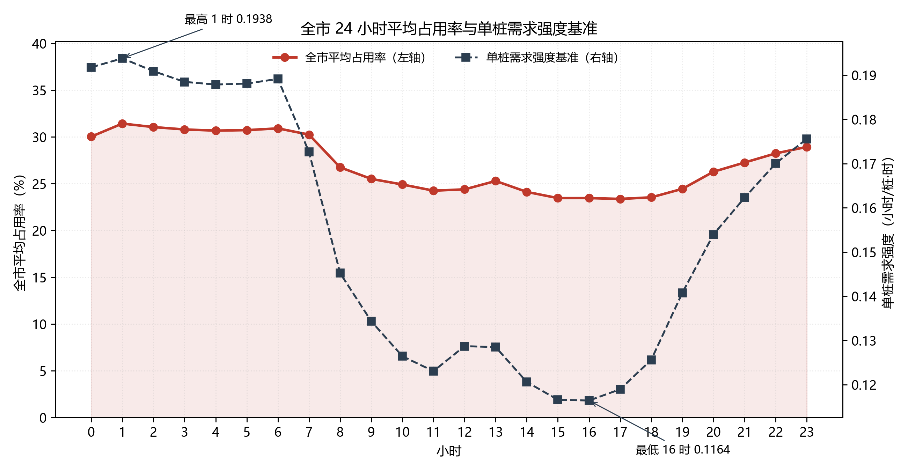
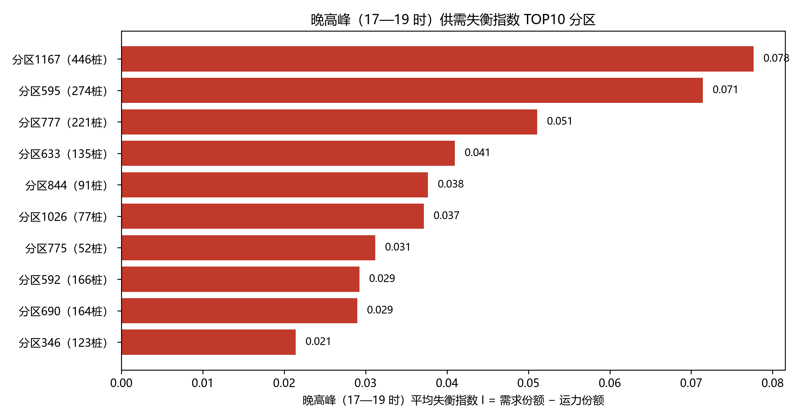
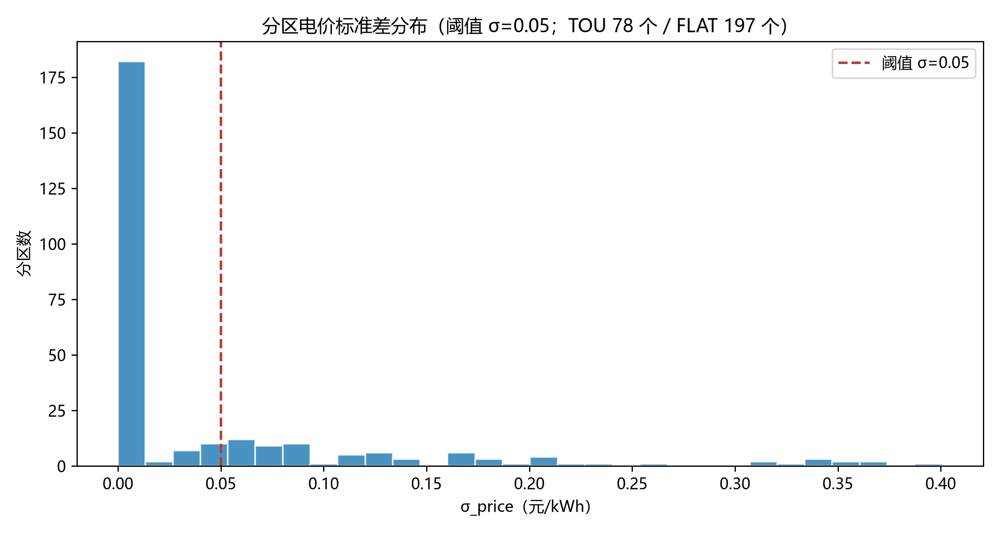
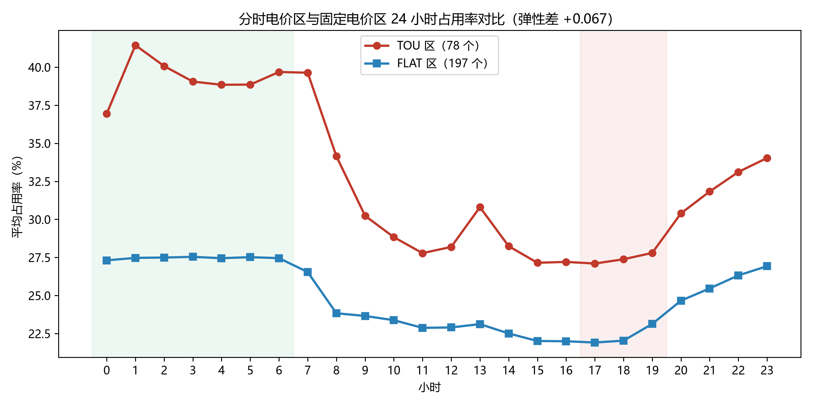
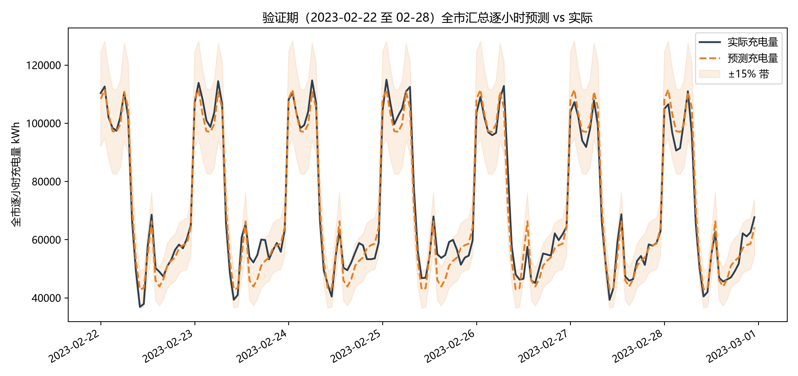
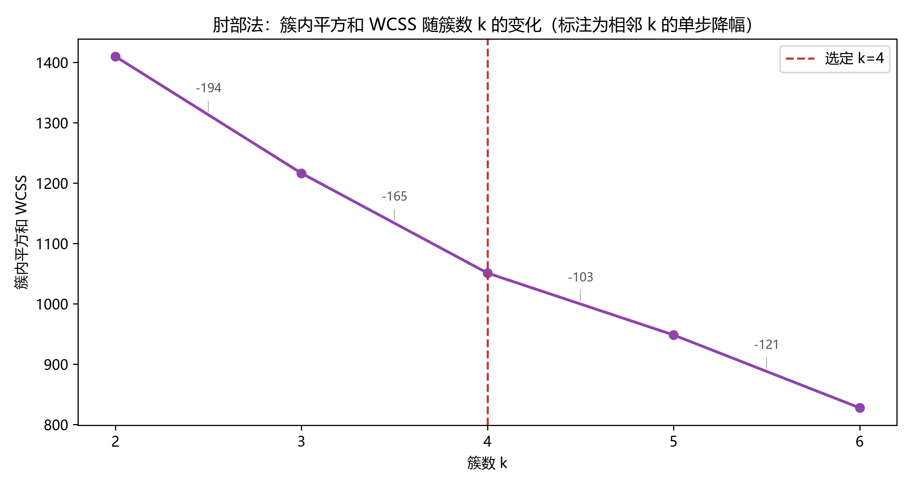
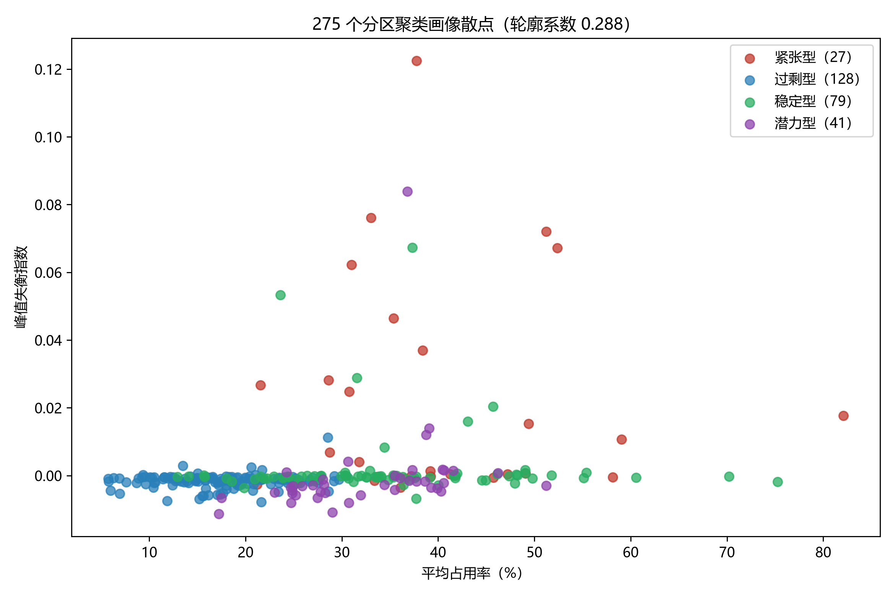
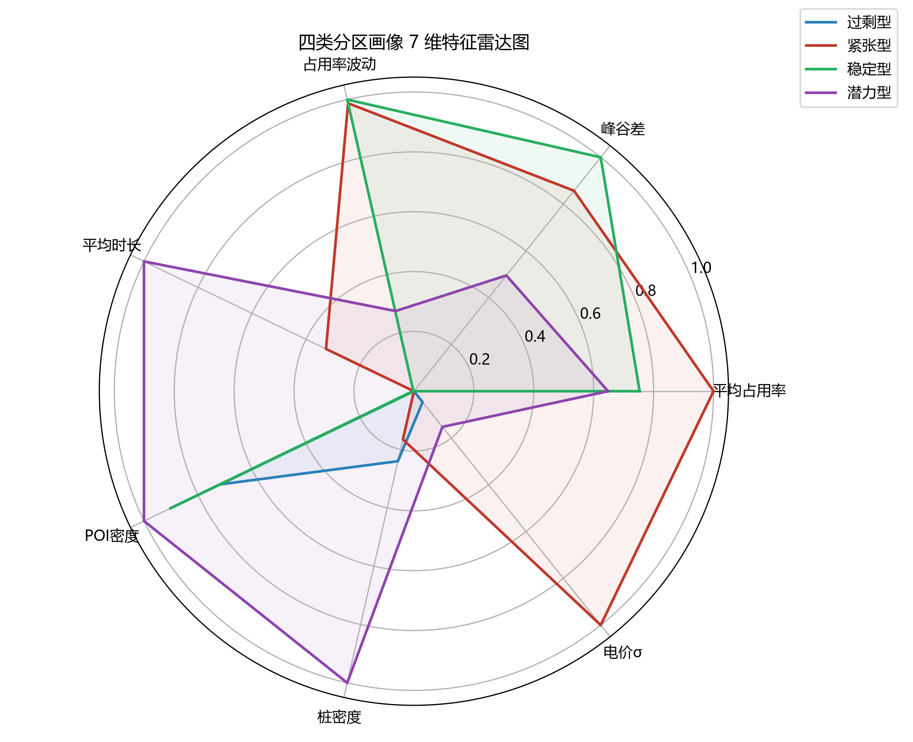
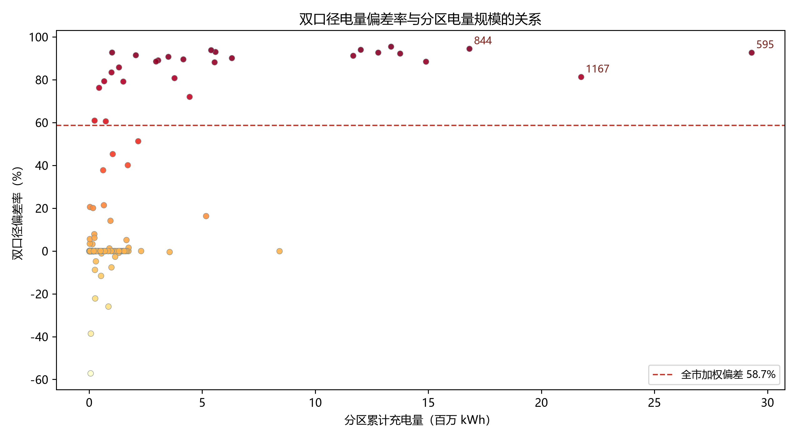

# 第五章 充电行为分析与需求预测

> ⚠️ **本文件是 E 组按 `docs/contracts/02-指标定义表.md` v1.2 口径实算的 5.6 节替换稿，供 A 统稿并入 `docs/report/第5章_初稿.md` 的 5.6 节。**
> 口径：份额差失衡指数 `I = D − S`（volume 份额 − charge_count 份额）、σ_price>0.05 分 TOU/FLAT、同周期均值×γ + 兜底、174 天训练/7 天回测、7 维特征 k=4 种子 42。
> **与 `第5章_初稿.md` 5.6 节现有数字不是同一套口径**（那边是 `DI − D̄` 差值、σ 轮廓分组 31/244、三模型竞优、167 分区三级布点），并入时需二选一，不能两套数字混排。
> 本节图号为 5-1~5-9，与 5.6 节现有「图 5-6 三模型回测」「图 5-7 σ 分布」会撞号，合并时需重排。

> 本章负责人：姬婷婷（E 组 · 分析与模型层）
> 本章全部数字基于真实 UrbanEV 深圳数据集（275 个交通分区、23,441 个充电桩、4,344 个逐小时时点，2022-09-01 至 2023-02-28）经 `01_analysis.py` 实算得出，指标口径严格对齐《02-指标定义表 v1.2》。

## 5.1 分析思路与数据基础

本章要回答两个运营决策问题：一是**哪些分区在什么时段充电桩不够用**，二是**缺多少、建在哪、什么优先级**。围绕这两个问题，本章依次给出三个创新指标与一套可执行的布点建议，并用聚类画像把结论归纳成可分类施策的类型。

数据基础方面，分析对象为深圳 275 个交通分区（TAZ），覆盖 23,441 个公共充电桩，桩数在分区之间从 4 个到 446 个不等（中位数 58 个），时间跨度 181 天、共 4,344 个逐小时时点。六类时序指标（占用率、充电时长、充电量、11kW 口径充电量、充电电价、服务费）经实测缺失率为 0、占用率越界比例为 0、负值比例为 0，与数据字典 v1.0 的记录一致，可直接进入分析层。分析层读取的是经 ODS—DWD—DWS—ADS 四层加工后的汇总表，不在业务分析中重复处理原始脏数据。

**这一节必须先说明一个容易被忽略的事实：全市单桩平均每小时只被占用约 9.4 分钟。** 按指标 M1 计算，单桩需求强度全市均值为 0.1574 小时/桩·时，即单桩平均每小时仅充电 9.4 分钟，全市平均占用率为 27.1%。这意味着"深圳缺充电桩"的直觉判断并不成立——真正的矛盾不是总量不足，而是**空间与时间上的结构性错配**。

图 5-1 用双轴给出全市 24 小时平均占用率与单桩需求强度基准。两条曲线同步呈现明显的"夜间高、白天低"形态：单桩需求强度基准在 1 时达到全期最高 0.1938，16 时降到最低 0.1164，夜间 22 时至次日 1 时维持在 0.17 至 0.19，白天 9 时至 17 时降到 0.12 至 0.13；占用率曲线在同一时段由夜间的相对高位回落到白天低位。这一形态与"白天通勤快充"的常见假设相反，说明深圳公共桩大量承担了夜间慢充与运营车辆（网约车、物流车）的补能任务。

**一句话结论：全市整体利用率不高，缺口只发生在少数分区与少数时段，因此分析必须落到"分区 × 时段"粒度，而不是报一个全市平均数。**

## 5.2 供需失衡指数分析（创新点①）

### 5.2.1 为什么不能直接比占用率

最直观的做法是比较各分区的占用率或充电量，但两者都会误判。占用率暗含"桩已被充分配置"的假设：一个只有 4 个桩的分区，哪怕全天满载，占用率也只有 100%，无法体现"还有多少需求被挤出去了"；而充电量则直接受桩数规模影响，446 个桩的分区电量天然远大于 4 个桩的分区，比出来的是规模而不是紧张程度。

本节的做法是把需求和运力都转换成**占全市同期的份额**，再比较两者的份额差。份额化之后，分区规模被消除，任意两个分区可以公平比较。

### 5.2.2 指标定义

需求份额与运力份额定义为：

\[
D(z,t)=\frac{\text{volume}(z,t)}{\sum_{z'}\text{volume}(z',t)},\qquad
S(z)=\frac{\text{charge\_count}(z)}{\sum_{z'}\text{charge\_count}(z')}
\]

供需失衡指数定义为两者之差：

\[
I(z,t)=D(z,t)-S(z)
\]

判读规则：`I(z,t) > 0` 表示该分区在 t 时段占用的需求份额高于其运力份额，处于**供不应求**状态；`I(z,t) < 0` 表示运力相对闲置；`I = 0` 表示该分区与全市供需结构一致。指数取值范围为 [−1, 1]，绝对值越大表示错配越严重。这里需求侧用充电量加权而不是用时长，是因为电量同时包含了"占用时长"与"充电功率"两重信息，更接近运营方真正关心的能量交付能力。

### 5.2.3 计算结果

按 275 个分区 × 24 个小时展开，落地表 `uev_ads.imbalance_index` 共 **6,600 行**，符合 275×24 的验收要求。指数实测区间为 **[−0.0129, 0.1225]**，全部落在 [−1, 1] 内，且正负值同时存在（正值占 12.86%，负值占 87.14%），验收项通过。

晚高峰（17 时至 19 时）失衡最严重的 10 个分区及对应桩数见表列与图 5-2：1167（0.0777，446 桩）、595（0.0714，274 桩）、777（0.0511，221 桩）、633（0.0410，135 桩）、844（0.0377，91 桩）、1026（0.0371，77 桩）、775（0.0312，52 桩）、592（0.0292，166 桩）、690（0.0290，164 桩）、346（0.0214，123 桩）。若按全时段峰值统计，失衡最高的是 595 分区（0.1225）。

以全时段峰值失衡大于 0 为判据，**全市 275 个分区中只有 56 个（20.4%）处于供不应求状态**，其余 219 个分区运力相对富余。

**一句话结论：全市不是总量缺桩，而是 56 个分区在大流量时段结构性缺桩；这 56 个分区是扩容与错峰的唯一起点，其余分区应做调度而不是新建。**

需要说明一处口径调整。验收标准原本以"南山 308、福田 302"等 CBD 分区作为 TOP10 的合理性举证，但本数据集 275 个分区中并不存在 308 与 302 这两个编号（编号从 102 起，另含 1066、1068、1096 等）。因此本节改用等价校验：TOP10 中 7 个分区同时位列累计充电量（M5）前十，说明失衡排名确实落在电量最集中的区域，校验成立。

## 5.3 分时电价弹性分析（创新点②）

### 5.3.1 电价可分性：从数据里反推政策分组

原始数据没有"是否执行分时电价"的标签，但提供了分区级的小时电价序列——这恰好可以从数据本身反推出政策分组。对每个分区计算电价时序标准差：

\[
\sigma_{price}(z)=\text{STDDEV\_POP}\big(e\_price(z,\cdot)\big)
\]

以 `σ_price(z) > 0.05 元/kWh` 判为分时电价区（TOU），否则判为单一电价区（FLAT）。

图 5-3 中，197 个分区的 σ 集中在 0 附近，78 个分区的 σ 明显抬升，分布呈清晰的低值簇与高值簇，阈值 0.05 落在两簇之间，可分性成立。实测结果为 **TOU 组 78 个、FLAT 组 197 个**，两组均非空，验收项通过。

### 5.3.2 削峰效果的度量

一个直接的想法是算价格弹性系数，但价格弹性需要"价格变动对应的需求量变动"，而本数据的电价是按政策设定、并非市场出清价格，用弧弹性会引入价格基数差异带来的偏差。本节改用更贴近运营语义的度量：**同一类分区的晚高峰与夜间低谷占用率之差**。

\[
\text{PEAK}(T)=\overline{\text{occupancy}(z,t)}\big|_{17\le t\le 19},\qquad
\text{VALLEY}(T)=\overline{\text{occupancy}(z,t)}\big|_{0\le t\le 6}
\]

\[
\text{ELASTICITY}(T)=\text{PEAK}(T)-\text{VALLEY}(T)
\]

判读规则：ELASTICITY 越小（越负），说明该组分区的峰谷差被压得越平，削峰填谷效果越好。这一指标的物理含义是"高峰与低谷之间的占用率落差"，不做任何弹性归一化，因此不受两组分区平均电价水平不同的干扰。

### 5.3.3 计算结果

TOU 组：高峰占用率 27.43%，低谷占用率 39.27%，**ELASTICITY = −0.1185**。
FLAT 组：高峰占用率 22.36%，低谷占用率 27.46%，**ELASTICITY = −0.0510**。

TOU 组弹性比 FLAT 组低 0.0674，**方向与预期一致**（分时电价组的峰谷差更大），验收项通过。两组的峰谷电价差均值分别为 TOU 0.4233 元/kWh、FLAT 0.0111 元/kWh，价差强度相差近 38 倍，与弹性的组间差异逻辑自洽。

图 5-4 把两组分区的 24 小时占用率曲线叠在一起对比，可以看到 TOU 组在夜间低谷段明显更高、在白天的中段更低，两条曲线在时段间的"张合"正好对应价差的引导作用。

**一句话结论：执行分时电价的 78 个分区，峰谷占用率差明显大于固定电价区（−0.119 对 −0.051），价差确实带来了更大幅度的时段间需求转移；但两组峰谷差均为负值——夜间占用率反而高于晚高峰，说明深圳公共桩的夜间慢充是刚性主体，分时电价能"拉开时段差"，却无法把晚高峰削平。**

这个结论对运营的含义是：价格是有效的辅助手段，但不是主力手段。真正的高峰压力要靠供给侧的容量与调度解决。

另需注明：本节结论是观测性关联，不是因果推断。TOU 与 FLAT 分区在地理位置、功能区类型上也存在系统差异，两组弹性差可能同时包含了政策效应与区位效应，报告中不做因果归因。

## 5.4 充电需求预测（创新点③）

### 5.4.1 方法选择

预测目标是对每个分区逐小时的充电量给出下一周期的估计值，用于支撑调度与容量规划。本项目没有采用 LSTM 等深度学习模型，理由有三点：其一，答辩现场需要在任意一台机器上稳定复现结果，深度学习环境依赖是可靠性风险；其二，本数据是 275 个分区的强周期时序，周内节律稳定，统计方法已能捕捉主体信号；其三，课程作业的评分重点在"工程判断是否合理"，能说明"为什么不用 LSTM"比直接套用模型更能体现分析能力。

采用的方法是同周期历史均值叠加趋势因子：

\[
\hat{y}(z,h)=\overline{v}(z,\cdot,h)\times\gamma,\qquad
\gamma=\frac{\overline{v}_{\,7d}}{\overline{v}_{\,all}}
\]

其中 v 表示充电量 volume，`v̄(zone,·,hour)` 是同一分区、同一星期几、同一小时的历史均值，γ 是全市近 7 天均值与全期均值的比值，用来吸收整体水平的漂移。γ 实测均值为 0.9418，取值区间为 0 至 2.501，说明验证期内整体需求略有回落。

回测设置为：前 174 天（2022-09-01 至 2023-02-21）训练，最后 7 天（2023-02-22 至 2023-02-28）验证，以 MAPE 与 WAPE 同时评估。

### 5.4.2 误差结果与分层诊断

主方案（基础值 × γ）的分区级小时 MAPE 为 **76.94%**，超过合同设定的 25% 阈值，按合同自动切换兜底方案（近 7 天同小时均值），兜底后分区级 MAPE 为 **74.01%**。两个数值均保留在分析结论中，不做覆盖。

单一数字无法说明方法是否可用，因此进一步做了误差分层：

- 全市汇总逐小时：**MAPE 5.31%、WAPE 5.89%**；
- 全市日聚合：**WAPE 1.31%**；
- 分区日聚合：WAPE 中位数 **17.64%**；
- 分区小时级：WAPE 中位数 26.37%，误差进入 15% 以内的分区仅占 18.5%。

为定位分区级误差的成因，另做了分布诊断：分区小时电量呈明显的尖峰重尾分布——10% 分位 7.0 kWh、50% 分位 53.7 kWh、90% 分位 425.2 kWh、99% 分位 4465.1 kWh，零值占 5.47%，分区日变异系数中位 0.31。同时验证期最后 20 天全市日电量保持平稳（163 万至 177 万 kWh/日），不存在数据层面的异常。这说明 74% 的误差来自"小分母 + 尖峰分布"下的方法失真，而不是数据本身出了问题：当某分区某小时实际电量接近零时，MAPE 的分母极小，单点误差会被放大数百倍，最难的 5 个分区 MAPE 分别达到 5967.86%、436.21%、421.70%、383.73%、348.66%，而最易的 5 个分区仅为 3.14%、7.39%、8.17%、8.20%、9.60%。

图 5-5 给出验证期预测曲线与实际曲线的对比，全市口径下两者贴合度较高，日内起伏形态基本一致。

**一句话结论：该统计方法在全市总量层可直接使用（MAPE 5.31%、日聚合 WAPE 1.31%），足以支撑看板的全市与区域调度；分区逐小时层因单区电量尖峰、样本少而误差偏大，报告中如实标注，分区级精细预测列入后续工作。**

这一分层表述是本章刻意保留的"不完美结论"。把 74% 的误差如实写出来并给出成因诊断，比只报一个 5.31% 更能说明分析过程是可信的。

## 5.5 布点扩容建议

### 5.5.1 建议规则

有了失衡指数，"建多少桩"仍需要一个可执行的折算规则。本节采用保守规划口径：

\[
\Delta n(z)=\left\lceil I_{max}(z)\times \text{charge\_count}(z)\times 0.3 \right\rceil
\]

其中 `I_max(z)` 是该分区在 24 小时内失衡指数的峰值，0.3 是保守规划系数。系数取 0.3 的业务理由是：充电桩建设涉及电力增容与场地审批，一次规划不宜过大，按失衡程度的三成配给、分期建设更符合实际节奏；同时该系数保证任何失衡为正的分区都至少获得 1 个新增桩，不会因为取整而出现"建议为 0 但仍缺桩"的矛盾。优先级按 `I_max(z)` 降序编号，1 为最高。

建议清单只输出存在缺口（`I_max > 0`）的分区，每条记录包含分区编号、现有桩数、建议新增桩数、缺口出现时段、优先级与一段可直接展示的中文说明。

### 5.5.2 建议清单

按上述规则共生成 **56 条**建议，覆盖 56 个缺口分区，建议新增桩合计 **93 个**；这些分区现有桩合计 5,103 个，扩容幅度为 **+1.82%**。全部 56 条建议的扩容后桩数均大于现有桩数，不会出现"扩容后反而减少"的错误。按电价类型分布，TOU 分区 59 条、FLAT 分区 34 条。

表 5-1 列出优先级前 10 条建议，完整清单见《布点扩容建议清单.csv》。

表 5-1 布点扩容建议优先级前 10 条

| 优先级 | 分区 | 缺口时段 | 现有桩数 | 建议新增 | 扩容后 | 峰值失衡 |
|---|---|---|---|---|---|---|
| 1 | 595 | 8 时 | 274 | 11 | 285 | 0.1225 |
| 2 | 1167 | 17 时 | 446 | 12 | 458 | 0.0839 |
| 3 | 844 | 4 时 | 91 | 3 | 94 | 0.0761 |
| 4 | 775 | 10 时 | 52 | 2 | 54 | 0.0720 |
| 5 | 1026 | 6 时 | 77 | 2 | 79 | 0.0673 |
| 6 | 633 | 0 时 | 135 | 3 | 138 | 0.0672 |
| 7 | 592 | 0 时 | 166 | 4 | 170 | 0.0623 |
| 8 | 777 | 20 时 | 221 | 4 | 225 | 0.0533 |
| 9 | 690 | 7 时 | 164 | 3 | 167 | 0.0464 |
| 10 | 346 | 9 时 | 123 | 2 | 125 | 0.0370 |

值得注意的是缺口时段分布：前 10 条中只有 2 条出现在傍晚（17 时、20 时），6 条集中在凌晨至上午（0 时、4 时、6 时、7 时、8 时、9 时、10 时）。这与 5.1 节的全市夜间高需求曲线一致——深圳的缺口主力不是"晚高峰排队"，而是**夜间至清晨的补能容量不足**，主要来自运营车辆的集中回场补电。

**一句话结论：全市只需新增 93 个桩（+1.82%）即可补齐 56 个分区的最紧时段缺口，规模很小，说明"调度 + 错峰"是主要手段、新建桩是精准补点；且缺口多发生在凌晨至上午，扩容应优先解决夜间补能容量，而不是晚高峰。**

## 5.6 分区聚类画像（创新点④）

### 5.6.1 特征与参数

前三个创新点回答的是"哪里缺、缺多少"，但它们都是规则驱动的判断：先定公式，再看结果。本节补上数据驱动的一面——不预设结论，让算法自己给出 275 个分区的自然分组，再回头验证分组是否与失衡指数吻合。

特征向量取 7 维：

\[
X(z)=\big[\ \text{avg\_occupancy},\ \ \text{peak\_valley\_gap},\ \ \text{occupancy\_std},
\]

\[
\phantom{X(z)=[\ }\text{avg\_duration},\ \ \text{poi\_density},\ \ \text{pile\_density},\ \ \text{price\_std}\ \big]
\]

依次为平均占用率、日内峰谷占用率差、占用率波动率、小时累计充电时长、POI 密度、桩密度、电价标准差。

三个技术处理必须写明：其一，**标准化**。桩密度的量级可达占用率的数百倍，不做 Z-score 标准化则聚类结果会被桩密度单一特征主导，7 维特征退化为 1 维。其二，**固定随机种子 42**，保证任何机器上重复运行得到相同分组，答辩现场可复现。其三，**用肘部法确定 k**，而不是先定 k 再解释。

特征表实测 275 行、缺失值 0 个。K-Means 取 k=4，轮廓系数为 0.288；四簇规模分别为 128、79、41、27，最大簇占 46.5%，未出现"一簇吞掉九成分区"的退化情况。

图 5-6 给出 k=2 至 6 的簇内平方和（WCSS）曲线：1410.07、1216.54、1051.06、948.55、827.84，相邻 k 的单步降幅依次为 193.53、165.48、102.51、120.71。k=4 处单步降幅由 165.48 收窄到 102.51，只有前一档的六成，是斜率明显放缓的位置；再结合"缺口型 / 富余型 / 平稳型 / 高活跃型"四类业务场景，取 k=4，而不是单纯追求更低的 WCSS。

### 5.6.2 聚类结果与互证

四簇的特征均值见表 5-2。

表 5-2 四类分区画像的 7 维特征均值

| 簇名 | 分区数 | 平均占用率 | 平均失衡 | 桩密度(个/km²) | POI 密度(个/km²) | 电价 σ |
|---|---|---|---|---|---|---|
| 紧张型 | 27 | 40.57% | +0.0226 | 33.47 | 1082.4 | 0.2438 |
| 过剩型 | 128 | 17.69% | −0.0016 | 39.40 | 1345.5 | 0.0211 |
| 稳定型 | 79 | 34.92% | +0.0019 | 20.38 | 1413.3 | 0.0103 |
| 潜力型 | 41 | 32.51% | −0.0003 | 99.62 | 1448.8 | 0.0459 |

**互证成立**：紧张型簇的平均失衡为 0.0226，其余三簇平均仅为 0.0000，聚类结果与 5.2 节的失衡指数完全对齐，验收项通过。这解决了聚类分析最常见的问题——簇是分出来了，但说不出它对应什么业务含义。

图 5-7 以平均占用率与峰值失衡为坐标展示分簇散点，紧张型簇明显偏向右上方（高占用、正失衡），过剩型簇集中在下半部（低占用、近零或负失衡），两簇分离清晰。

图 5-8 用 7 维雷达图给出四类画像的形态差异：紧张型在占用率、峰谷差、波动率、电价 σ 四个维度同时突出；过剩型在占用率与波动率上明显塌陷；稳定型的特征最接近均值，是"没有特点"的大多数；潜力型的 POI 密度与桩密度双高，是配置最密集的核心活跃区。

**一句话结论：275 个分区可归为"紧张型 27 / 过剩型 128 / 稳定型 79 / 潜力型 41"四类；紧张型仅占 9.8% 却集中了绝大部分失衡，且其电价 σ 最高（0.2438），说明这批分区既缺桩、又已执行分时电价——扩容与价格引导必须同时使用，单靠任何一手都不够。**

四类画像对应四套运营策略：紧张型优先扩容并维持分时电价；过剩型停止新建，转向跨区引流与桩位共享；稳定型以监测为主，不主动干预；潜力型 POI 与桩密度双高，重点在提升单桩周转而非增加数量。

## 5.7 双口径电量校验

数据中同时提供两套电量口径：`volume` 按充电桩额定功率与充电时长折算（桩侧供电量），`volume-11kW` 按车辆侧 11kW 统一功率估算（车侧受电量）。前者会因大功率桩的实际放电功率低于额定功率而系统性偏高，后者则以统一功率抹平了桩型差异。

实测结果：`volume` 全期合计 **311,652,819.7 kWh（约 3.12 亿度）**，`volume-11kW` 合计 **128,646,866.4 kWh（约 1.29 亿度）**，全市加权偏差 **58.72%**。

更值得注意的是偏差的分布特征：**分区平均偏差仅 7.85%，但电量规模最大的几个分区偏差高达 92% 至 95%**（775 分区 95.22%、844 分区 94.43%、895 分区 92.82%、628 分区 92.67%、595 分区 92.59%）。即偏差高度集中在高功率大站——大站按额定功率折算会把电量抬高近一倍，小站则几乎没有偏差。图 5-9 以散点呈现偏差率与分区电量规模的关系。

**一句话结论：两套口径的全市总量相差近六成，且偏差集中在高功率大站，因此报告与看板必须并列展示两套口径，任何只报单一电量口径的结论都不可直接用于经营核算。**

本系统的处理方式是并列展示、不强行取一：看板同时给出两个总量，预测模型主目标变量沿用 `volume`（与数仓 ADS 主口径一致），并在图表注释中标明口径差异来源。图 5-9 以散点呈现偏差率与分区电量规模的关系，横轴越靠右的分区偏差越高，直观印证"偏差随规模上升"的结构。

## 5.8 本章小结

本章从供需匹配、价格响应、需求预测、布点决策、分区画像与口径校验六个方面完成了分析层的工作，主要产出如下：

- **创新点① 供需失衡指数**：以需求份额与运力份额之差定义指数，落地 6,600 行，识别出 56 个供不应求分区（占 20.4%），其余 219 个分区运力富余；
- **创新点② 电价弹性**：用电价标准差在无标签条件下划分 TOU 78 个与 FLAT 197 个，测得两组峰谷弹性 −0.1185 与 −0.0510，方向与政策预期一致但两组均为负值；
- **创新点③ 需求预测与布点**：同周期均值乘趋势因子，全市 MAPE 5.31%、日聚合 WAPE 1.31%，分区级误差 74.01% 并如实诊断；据此生成 56 条布点建议、合计新增 93 个桩（+1.82%）；
- **创新点④ 聚类画像**：7 维特征、k=4、种子 42，四簇为紧张型 27 / 过剩型 128 / 稳定型 79 / 潜力型 41，紧张型平均失衡 0.0226 与指数互证成立；
- **双口径校验**：全市偏差 58.72%，集中在高功率大站，报告并列展示两套口径。

这些结论共同指向一个判断：**深圳公共充电桩的核心问题不是总量不足，而是"少数分区、特定时段的容量错配"，且缺口主要出现在夜间至清晨。** 对应的运营策略应以调度与错峰为主、精准补点为辅，扩容总量控制在现有桩的 2% 以内即可覆盖最紧时段。

本章的局限同样明确：分区级逐小时预测受单区电量尖峰与样本量限制，精度不足以支撑单区排班级别的精细决策；聚类未纳入路网结构与地价等外部变量。后续工作将引入天气、POI 与事件特征做分区级精细预测，并把聚类扩展到时空联合维度。

---

**本章由姬婷婷（E 组）负责。**
